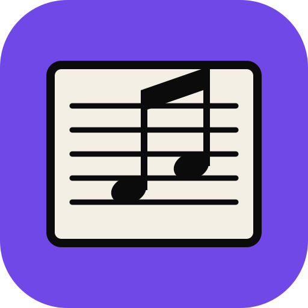
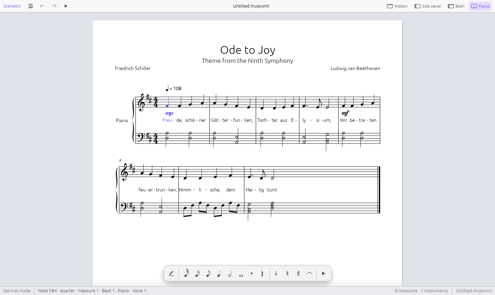
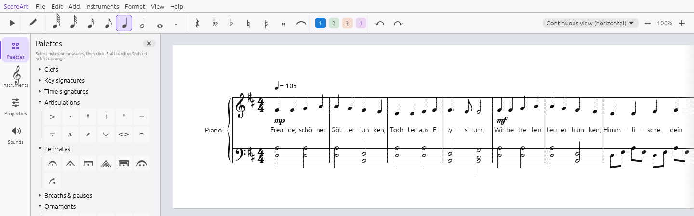
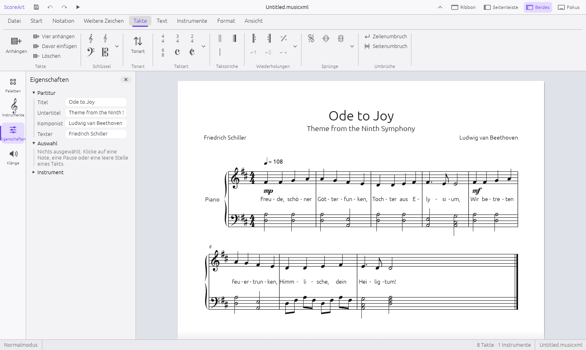
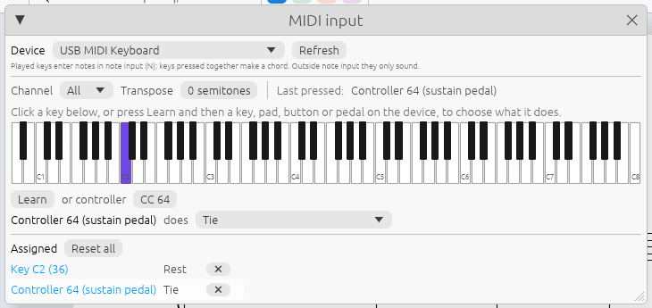

<p align="center">
  
</p>

<h1 align="center">ScoreArt</h1>

<p align="center">
  <b>An open-source music notation editor, built in pure Rust.</b><br>
  Write, engrave and share sheet music — natively on Linux, macOS and Windows, and in the browser via WebAssembly.
</p>

<p align="center">
  
  
  
  
</p>


ScoreArt is a scorewriter in the spirit of MuseScore, written from scratch. It follows the
engineering conventions of the ArtCraft apps (Rust only, egui, one command registry for UI,
CLI and agents, WebAssembly build, strict clean-room rules) — but it is an **independent
project, not affiliated with ArtCraft / storytold or with MuseScore / Muse Group.**

## What works today

- **Four interface layouts**, switched in the title bar (or *View → Interface*) and remembered:
  - **Ribbon**: tabs of grouped buttons, as in the ArtCraft office apps;
  - **Side panel**: menus, a toolbar and the MuseScore-like side panel;
  - **Both** (the default);
  - **Focus**: only the score and a floating input bar.

  The ribbon tabs are ordered by how often they are needed:
  - *Home*: note input, durations, accidentals, voices, editing and playback;
  - *Notation*: the everyday marks (articulation, dynamics, slurs and hairpins, breath, grace notes);
  - *More symbols*: the rare marks (ornaments, techniques, octave and pedal lines, tremolos,
    noteheads …);
  - then *Measures*, *Text*, *Instruments*, *Format* and *View*.

  Buttons that cannot act on the current selection are greyed out, and their tooltip says why.
  Double-clicking a tab or pressing Ctrl+F1 folds the ribbon.

  

- **Engraving** with the SMuFL reference font Bravura: clefs, key and time signatures, notes,
  chords (with seconds displaced), rests and whole-measure rests, accidentals (key- and
  measure-aware), dots, ledger lines, stems, flags, **beams** (grouped by beat, sloped, with
  secondary beams and beamlets), **ties** (also across systems), lyrics, tempo marks, tuplet
  numbers, barlines, braces and brackets, instrument names, measure numbers, title block —
  with automatic spacing, justified system breaks and page breaks.
- **The full set of notation marks** (at least what MuseScore's palettes offer), each one
  displayed, editable, saved and read back through MusicXML:
  - 12 **articulations** (accent, staccato, staccatissimo ×3, tenuto, portato, marcato, stress,
    unstress, soft accent, laissez vibrer) and 7 **fermatas** (normal, short, long, very short,
    very long, Henze long/short);
  - **breaths and pauses** (4 breath marks, 4 caesuras), 19 **ornaments** (trill, short trill,
    mordent, tremblement, prall-mordent, up/down prall, up/down mordent, prall up/down, turns,
    shake, schleifer, Haydn), **techniques** (up/down bow, harmonic, thumb position, open,
    stopped, half open, snap and left-hand pizzicato) and **jazz slides** (scoop, plop, doit, fall);
  - 30 **dynamics** from pppppp to ffffff with sf, sfz, sffz, sfp, rfz, fz, fp, pf, n …;
  - **lines**: slurs, crescendo/diminuendo hairpins and cresc./dim. lines, 8va/8vb/15ma/15mb/
    22ma/22mb (notes are displaced on screen, sound at pitch), pedal, trill and vibrato lines,
    let ring, palm mute, straight and wavy glissandos — drawn across system breaks;
  - **grace notes** (acciaccatura, appoggiatura, 16th, 32nd), single-note **tremolos** (1–4
    strokes, buzz roll), **arpeggios** (normal, up, down, bracket), **noteheads** (x, diamond,
    slash, triangle, circle-x, cross, circled, parenthesised);
  - **repeats and jumps**: voltas, segno, coda, varied coda, Fine, To Coda, D.C., D.S. and their
    al Fine/al Coda forms, one-measure repeat sign; **rehearsal marks**, **tempo markings**,
    **chord symbols**, **fingerings**, **staff text** and system text.
- **Note input** the way scorewriter users expect: `N` toggles note input, `A`–`G` enter
  pitches (octave nearest the previous note, key signature applied), `1`–`8` pick durations
  (5 = quarter), `.` dots, `0` rests, `Shift+A`–`G` add chord notes, `↑`/`↓` semitones,
  `Ctrl+↑/↓` octaves, `T` ties, `Del` deletes, notes crossing a barline are split and tied,
  four voices, mouse input with a ghost note. **Drag notes with the mouse**: up or down changes
  the pitch step by step along the staff, sideways (or into another measure or staff) moves the
  note to that beat — a rest takes its old place, its marks and lyrics go along; a preview
  notehead shows where it lands.
- **Two tools, pen and hand** (in the ribbon, the toolbar and the focus bar): with the **pen**
  (`N`) a click writes a note where the ghost note shows; with the **hand** (`Esc`) a click
  selects and a drag moves — notes, and also **staff texts and dynamics**, which keep their new
  place in MusicXML (`relative-x`/`relative-y`) and come back with their MuseScore offsets.
  Double-clicking a staff text edits it. The mouse pointer shows a hand over anything that can
  be picked up.
- **Side panel** like MuseScore's: a strip of tabs on the left — **Palettes**, **Instruments**,
  **Properties**, **Sounds** — switches what the panel shows; clicking the open tab folds it away.
- **Editing**: selection of notes, rests, note ranges (`Shift+click`, `Shift+→`) and measure ranges; palettes for every mark above; add/insert/delete measures; add,
  rename, **change**, reorder and remove instruments (20 built-in, including Women, Men and SATB
  choir) in the **Instruments** tab (`I`). Changing an
  instrument that holds several lines (Women → Soprano) asks whether to **merge** them, **split**
  one off into the new instrument (the alto stays in Women) or **keep only one**; any line can
  also get an instrument of its own. **Instrument changes inside a part**
  ("To Flute", played and exported to MIDI); show or hide instruments; line and page breaks;
  **lyrics with several verses and hyphens**; transpose; score properties; unlimited undo/redo.


- **Views and page format**: page view, continuous view (one endless system) and continuous
  vertical view; **Format → Page settings**: paper size (A4, Letter, A3 …), portrait or
  landscape, all four margins, staff size, distances between staves, instruments and systems,
  note spacing. Saved in the file (MusicXML `<defaults>`), read from MuseScore styles.

<p>
  
  
</p>

- **Languages**: the whole interface in **English and German** (*View → Language*; the
  system or browser language is used at first and the choice is remembered). Every text has
  to have a German translation: a test fails otherwise (`crates/ui-egui/src/i18n_de.rs`).



- **MIDI keyboard input** (desktop and browser): connect a device, play notes and chords into
  the score; **every key and controller can be given its own action** (note value, rest, tie,
  undo, play …) by clicking it on the keyboard picture or with *Learn*. Bindings are kept.



- **Files**: **MusicXML 4.0** is the native format (`.musicxml` and compressed `.mxl`, read and
  write — exchange scores with MuseScore, Dorico, Sibelius, Finale), **MuseScore files**
  (`.mscz`, `.mscx` of MuseScore 3 and 4, checked against files saved by MuseScore Studio 4.7)
  open directly with notes, marks, lines, chord symbols, repeats and jumps (saving writes
  MusicXML), **MIDI** import (each beat quantised to the simplest fitting grid: down to 64ths, triplets,
  quintuplets, septuplets; MuseScore's one-track-per-staff
  files become parts with their staves) and export,
  **SVG** export with real glyph outlines, **WAV** export.
- **Web build** with a `?host=parent` `postMessage` bridge (`scoreart:ready/open/save/dirty`) so
  a same-origin page — for example a Nextcloud app — can open and save scores in it.
- **Playback** with ScoreArt's own built-in synthesizer (no soundfont needed): `Space` plays
  from the selection with a moving playhead, notes sound while you enter them. **Everything
  printed is heard**:
  - repeats with first/second/third endings, D.C., D.S., al Fine, al Coda;
  - fermatas, breath marks and caesuras;
  - accel., rit., allargando and a tempo as gradual tempo changes;
  - swing;
  - trills, mordents, turns and other ornaments, tremolos and glissandos;
  - octave lines, pedal and let ring;
  - hairpins as real swells, also on held notes.

  Each instrument family plays its own way: slurred notes bind, staccato is shorter for bows
  and winds than for keys. **Every note lives**: it grows into its sound, rounds and lets go
  (staccato quickly, accents with a push, slurred notes carrying on, long notes in a slow
  arch). All of this is **sound optimisation**, on by default and switched off with
  *Instruments → Sound optimization*. Desktop audio via cpal, Web Audio in the browser; **WAV** export.
  How it works: [docs/playback.md](docs/playback.md).
- **Sample playback and a mixer** (`F10`): load free sample libraries — **SoundFont** (`.sf2`)
  and **SFZ** (`.sfz` with WAV/FLAC samples, also as a folder or zip), e.g. VSCO 2 CE (CC0),
  Salamander Grand Piano, GeneralUser GS. **Every instrument is its own track** with its own
  sound (library and preset), volume, pan, mute, solo and level meter; the choice is saved in
  the score. **Audio per instrument** export writes one WAV per instrument (stems).

  **The notation picks the samples**: with a library like VSCO 2 CE, staccato notes play its
  spiccato or staccato sound, "pizz." its pizzicato, tremolo strokes its tremolo, "con sord."
  its muted sound. Every sound is measured once and brought to a common loudness. A room
  (reverb) and a subtle human touch are added; both can be set in the mixer and are saved with
  the score.
  **Free sound libraries** can be fetched from inside ScoreArt: tick several instruments, or
  fetch the **whole library with one click** (everything not loaded yet). The licence is
  shown in full and must be explicitly accepted once for the batch; the instruments are then
  downloaded one after the other with progress ("instrument 3 of 75") and can be cancelled
  (licence and acceptance are saved with the files). See
  [docs/sounds.md](docs/sounds.md) for the libraries, their licences and how they compare with
  Muse Sounds.


- **CLI** for conversion and for driving every command headlessly (agents, scripts).

Not yet: PDF export, tuplet input, multi-measure rests, part extraction, transposing
instruments, percussion and tablature, two-note tremolos — see [ROADMAP.md](ROADMAP.md).

## Build and run

Needs Rust ≥ 1.90. On Linux the desktop app needs the ALSA headers (`libasound2-dev`).

```bash
cargo run --release -p scoreart -- [score.musicxml]        # desktop app
cargo run --release -p scoreart-cli -- convert sample out.svg
cargo run --release -p scoreart-cli -- convert sample out.wav --sounds GeneralUser-GS.sf2   # samples
cargo run --release -p scoreart-cli -- convert score.musicxml stems.zip    # one WAV per instrument
cargo run --release -p scoreart-cli -- commands             # every command id
cargo run --release -p scoreart-cli -- run --new \
  --cmd 'note.enter={"step":"c"}' --cmd 'note.enter={"step":"e"}' --save out.musicxml

# Web (needs `rustup target add wasm32-unknown-unknown` and `cargo install trunk`)
cd apps/scoreart-web && trunk serve        # http://127.0.0.1:8790
trunk build --release                      # → dist/web/
```

Quality gate before every commit: `cargo xtask ci` (fmt, clippy `-D warnings`, tests, asset
attribution, crate layering, wasm build).

## Keyboard

| Key | Action | Key | Action |
|---|---|---|---|
| `N` | note input on/off | `Esc` | leave note input / clear selection |
| `A`–`G` | enter note | `Shift+A`–`G` | add note to chord |
| `1`…`8` | 64th … breve (5 = quarter) | `.` | dot |
| `0` | rest | `T` | tie |
| `↑` `↓` | semitone up/down | `Ctrl+↑` `Ctrl+↓` | octave |
| `Alt+Shift+↑/↓` | diatonic step | `←` `→` | previous/next note |
| `Ctrl+←/→` | previous/next measure | `Ctrl+Alt+↑/↓` | staff above/below |
| `Ctrl+Alt+1…4` | voice | `Del` | delete |
| `Ctrl+B` | append measure | `Ins` | insert measure |
| `Ctrl+Z` / `Ctrl+Y` | undo / redo | `Ctrl+L` | lyric |
| `Ctrl+S` / `Ctrl+Shift+S` | save / save as | `Ctrl+O` / `Ctrl+N` | open / new |
| `Space` | play / stop | `Esc` | stop playback |
| `S` | slur over the selection | `<` / `>` | crescendo / diminuendo hairpin |
| `/` | grace note | `Shift+→` | extend the selection |
| `Ctrl+K` | chord symbol | `Ctrl+T` / `Ctrl+M` | staff text / rehearsal mark |
| `F10` | mixer | `I` | instruments and sounds |
| `Ctrl+F1` | fold or unfold the ribbon | | |

## How it is built

| Layer | Crate | Job |
|---|---|---|
| L1 | `model` | score model and edit primitives |
| L2 | `musicxml`, `midi`, `engrave` | MusicXML I/O · MIDI · layout to a display list |
| L3 | `render`, `synth` | SVG export with Bravura outlines · sound engine: mixer, built-in synthesizer, SoundFont and SFZ sampler |
| L4 | `engine` | session, undo, command registry |
| L6 | `ui-egui` | the egui front end |
| apps | `scoreart`, `scoreart-cli`, `scoreart-web` | desktop, CLI, browser |

Details: [docs/architecture.md](docs/architecture.md). Research and plan: [docs/plan.md](docs/plan.md).

## Legal

- Code: **MIT OR Apache-2.0** ([LICENSE-MIT](LICENSE-MIT), [LICENSE-APACHE](LICENSE-APACHE)).
- Sounds: **no sample library is bundled**; users load their own (see [docs/sounds.md](docs/sounds.md)).
  Muse Sounds are proprietary and not used.
- Music font: **Bravura** © Steinberg Media Technologies GmbH, SIL Open Font License 1.1,
  bundled unmodified ([assets/fonts/OFL-Bravura.txt](assets/fonts/OFL-Bravura.txt)). Every asset
  is listed in [ATTRIBUTION.md](ATTRIBUTION.md); see also [NOTICE](NOTICE).
- **Clean room**: no MuseScore (GPL) or other copyleft notation code is read or used; file
  formats come from public specifications (MusicXML 4.0 and SMuFL 1.4 of the W3C Music Notation
  Community Group, Standard MIDI File 1.0). Rules for contributors and agents: [AGENTS.md](AGENTS.md).
- MuseScore is a trademark of Muse Group; Sibelius of Avid; Finale of MakeMusic; Dorico of
  Steinberg. These names are used only to describe file compatibility. ScoreArt is not
  affiliated with, sponsored or endorsed by any of them, nor by ArtCraft / storytold.
