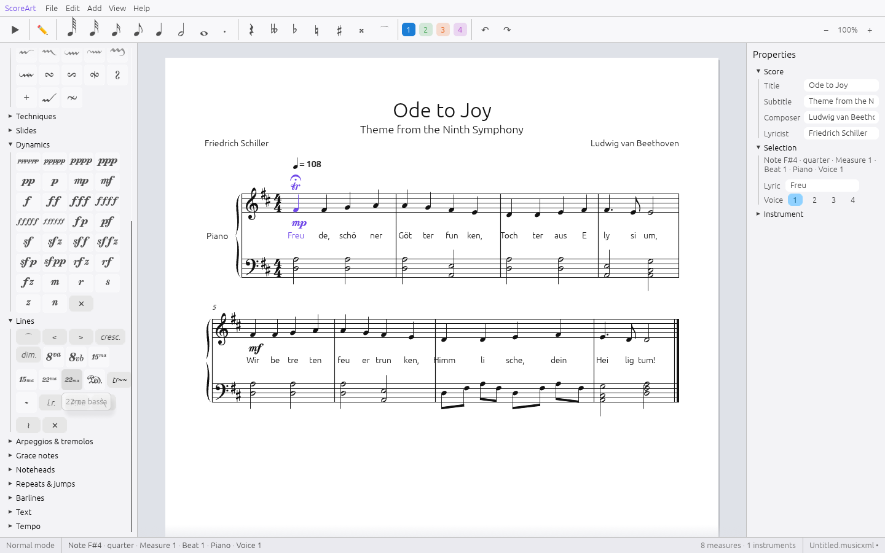
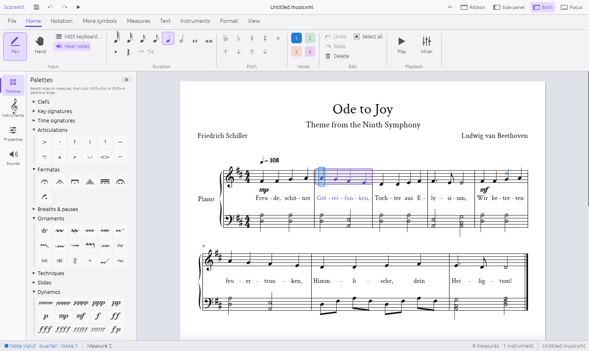
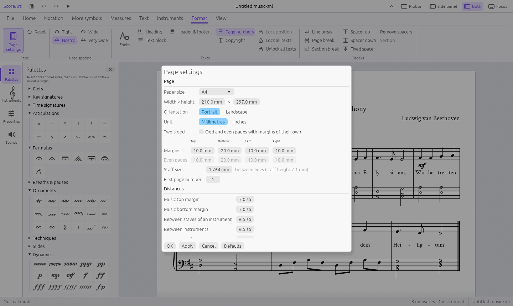

<p align="center">
  
</p>

<h1 align="center">ScoreArt</h1>

<p align="center">
  <b>Write, print and play sheet music — free and open source.</b><br>
  For Windows, macOS, Linux and the web browser.
</p>

<p align="center">
  
  
  
  
  <a href="https://buymeacoffee.com/manueldell"></a>
</p>



## What is ScoreArt?

ScoreArt is a program for writing music the way it is printed: notes on staves, with lyrics,
dynamics, chord symbols and everything else a score needs. You type or click the notes in,
ScoreArt sets them beautifully on the page, plays them back to you, and saves them in a format
every other notation program understands.

- 🎼 **Write music quickly** — type `C D E`, click with the mouse, or play on a MIDI keyboard.
- 🖨️ **Pages that look printed** — clean spacing, page numbers, headers and footers, title
  pages, exactly like in professional engraving programs.
- 🔊 **Hear what you write** — built-in sounds, or free sample libraries for real instruments.
- 🔄 **Open what you already have** — files from **MuseScore** (2, 3 and 4), **Sibelius**,
  **Finale**, **Dorico** and other programs (via MusicXML), and MIDI files.
- 📄 **PDF in and out** — export every page as PDF; open a PDF to keep it next to your score,
  or let ScoreArt turn a PDF from a notation program (MuseScore, Sibelius, Finale, Dorico,
  LilyPond …) back into an editable score.
- 🌍 **English and German** interface.
- 💸 **Free forever**, no account, no subscription, no tracking.

## Get started

1. **Download** ScoreArt for your computer from the
   [Releases page](https://github.com/ManuelDell/scoreart/releases) (Windows, macOS, Linux), or
   use the **web version** from the same page in your browser.
2. **Start it** — a sample song opens, so you can look around and press **Space** to listen.
3. **Make your own score**: *File → New*, choose your instruments, and start writing.

The [**user guide**](docs/guide/README.md) walks you through everything, with pictures —
also in German: [**Handbuch auf Deutsch**](docs/guide/de/README.md).

| | |
|---|---|
| [Getting started](docs/guide/01-getting-started.md) | The window, the ribbon and the side panel, your first score |
| [Writing music](docs/guide/02-writing-music.md) | Notes, rests, chords, voices, lyrics — with keyboard, mouse or MIDI keyboard |
| [Marks and lines](docs/guide/03-marks-and-lines.md) | Dynamics, articulation, slurs, hairpins, repeats, chord symbols |
| [Pages and layout](docs/guide/04-pages-and-layout.md) | Paper size, margins, breaks, spacing, headers and footers |
| [Texts](docs/guide/05-texts.md) | Title, composer, headings, fonts, moving and locking texts |
| [Instruments](docs/guide/06-instruments.md) | Adding, changing and arranging instruments |
| [Playback and sounds](docs/guide/07-playback-and-sounds.md) | Listening, the mixer, free sound libraries, audio export |
| [Files](docs/guide/08-files.md) | Opening MuseScore, MusicXML, MIDI and PDF files; saving and exporting |
| [Keyboard shortcuts](docs/guide/09-keyboard.md) | Every key at a glance |

<p>
  
  
</p>

## Good to know

- ScoreArt is **young** (version 0.1, alpha). It already writes, prints and plays real
  scores, but some things are still missing — among them tuplet input, parts,
  multi-measure rests and reading scanned sheet music. See the [roadmap](ROADMAP.md).
- Your scores are saved as **MusicXML**, the open exchange format of music notation. Any
  other notation program can open them, so your music is never locked in.
- ScoreArt is an **independent project**. It is not made by, affiliated with or endorsed by
  MuseScore / Muse Group, Avid (Sibelius), MakeMusic (Finale), Steinberg (Dorico) or
  ArtCraft / storytold. Those names appear only to say which files ScoreArt can open.

---

## For developers

ScoreArt is written entirely in **Rust**, with an [egui](https://github.com/emilk/egui) user
interface that runs natively and in the browser (WebAssembly). It is organised the way the
[ArtCraft apps](https://getartcraft.com/apps) (WordCraft, GridCraft …) are: small crates in
strict layers, one registry of commands that the interface, the command line and scripts all
use, and an open standard as the native file format.

```bash
cargo run --release -p scoreart -- [score.musicxml]          # desktop app
cargo run --release -p scoreart-cli -- convert sample out.svg  # command line
cd apps/scoreart-web && trunk serve                            # web app on http://127.0.0.1:8790
```

Needs Rust ≥ 1.90; on Linux also the ALSA headers (`libasound2-dev`). Before every commit:
`cargo xtask ci` (format, lints, tests, asset licences, layering, WebAssembly build).

The [**technical documentation**](docs/technical/README.md) explains how it is built:

| | |
|---|---|
| [Architecture](docs/technical/architecture.md) | Crates and layers, the score model, the engraver, the command registry, the apps |
| [Built like the ArtCraft apps](docs/technical/artcraft-conventions.md) | Which conventions ScoreArt shares with WordCraft and GridCraft, and why |
| [File formats and compatibility](docs/technical/file-formats.md) | MusicXML, MuseScore 2/3/4, MIDI, PDF, SVG, WAV — and how they are tested against other programs |
| [Testing and quality](docs/technical/testing.md) | The CI gate, never-crash rules, corpus checks |
| [Playback](docs/playback.md) · [Sounds](docs/sounds.md) | How a score is performed; sample libraries and the mixer |
| [Command line](docs/technical/command-line.md) | Converting files and driving every command from scripts and agents |

Contributing: read [AGENTS.md](AGENTS.md) first — it holds the rules for this repository, above
all the **clean-room rules** (no MuseScore or other GPL notation code is ever read or used).

## Support

ScoreArt is free and stays free. If it is useful to you and you would like to say thanks, you
can [buy me a coffee](https://buymeacoffee.com/manueldell) ☕ — bug reports and ideas in the
[issues](https://github.com/ManuelDell/scoreart/issues) help just as much.

## Licence

- Code: **MIT OR Apache-2.0** ([LICENSE-MIT](LICENSE-MIT), [LICENSE-APACHE](LICENSE-APACHE)).
- Music font **Bravura** and text font **Crimson Text**, both SIL Open Font License 1.1, bundled
  unmodified ([assets/fonts](assets/fonts)). Every asset is listed in
  [ATTRIBUTION.md](ATTRIBUTION.md); see also [NOTICE](NOTICE).
- No sample library is bundled; you load your own ([docs/sounds.md](docs/sounds.md)).
- MuseScore is a trademark of Muse Group, Sibelius of Avid, Finale of MakeMusic, Dorico of
  Steinberg; they are named only to describe file compatibility.
