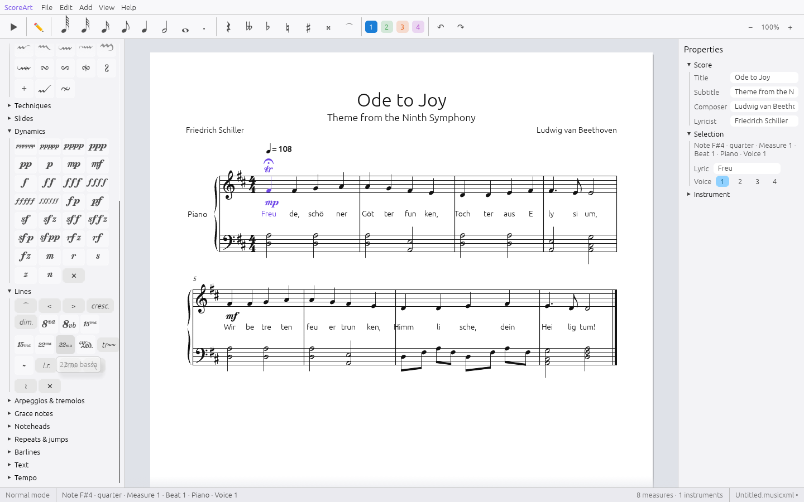
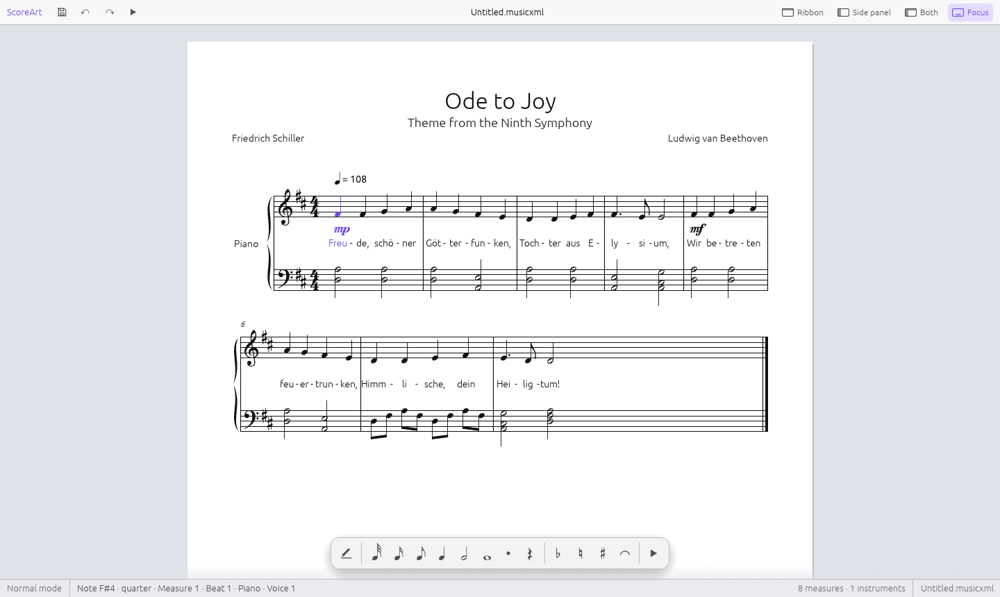

# Getting started

## Install

**Without installing:** open **https://manueldell.github.io/scoreart/** in your browser.

Or download ScoreArt from the [latest release](https://github.com/ManuelDell/scoreart/releases/latest):

| Your computer | Download | Then |
|---|---|---|
| **Windows** | `scoreart-…-windows.zip` | Unpack it and start `scoreart.exe`. Windows may say *"Windows protected your PC"*: choose *More info → Run anyway*. |
| **macOS** (Apple Silicon and Intel) | `scoreart-…-macos.zip` | Unpack it, drag **ScoreArt.app** into *Applications* and open it. The first time macOS says it cannot check the app: *System Settings → Privacy & Security → Open Anyway*. |
| **Linux** | `scoreart-…-linux.tar.gz` | Unpack it and start `./scoreart`. |
| **Your own web server** | `scoreart-…-web.zip` | The browser version to host yourself; it runs entirely in the browser. |

The warnings appear only because ScoreArt is not signed with a paid certificate. Every download
holds a `START-HERE.txt` with these steps.

You can also build it yourself from the source code — see the [README](../../README.md#for-developers).

## The window

- **Title bar** (top): save, undo, redo, play; the file name; and the switch between the four
  **layouts** — *Ribbon*, *Side panel*, *Both* (the default) and *Focus*.
- **Ribbon**: tabs of buttons grouped by task. *Home* has what you need all the time (note
  input, durations, accidentals, voices, playback); *Notation* and *More symbols* hold the marks;
  then *Measures*, *Text*, *Instruments*, *Format* and *View*. A greyed-out button cannot act on
  what is selected — its tooltip tells you why. Double-click a tab (or press `Ctrl+F1`) to fold
  the ribbon away.
- **Side panel** (left): *Palettes* with every mark, *Instruments*, *Properties* of the
  selection, and *Sounds*. Click the open tab again to fold the panel.
- **The score** in the middle, as it will be printed.
- **Status bar** (bottom): what is selected, the input mode, the size of the score.

**Focus** shows nothing but the score and a small floating bar — good for writing without
distraction:

## Your first score

1. *File → New score…* (`Ctrl+N`).
2. Give it a title and composer, pick the **instruments** (piano, voice, choir, strings, winds
   …), the **time signature**, **key**, number of measures and tempo.
3. Click **Create**. The empty score appears, ready for notes — continue with
   [Writing music](02-writing-music.md).

To look around first, *File → Examples → Ode to Joy* opens the sample song. Press **Space** to
hear it.

## Undo, save, zoom

- **Undo / redo**: `Ctrl+Z` / `Ctrl+Y` — as often as you like.
- **Save**: `Ctrl+S`. ScoreArt saves MusicXML (`.musicxml`), which every notation program can
  open. See [Files](08-files.md).
- **Zoom**: `Ctrl +` / `Ctrl −`, or *View → Zoom*. *View* also switches between **page view**,
  **continuous view** (one endless line) and a vertical view.
