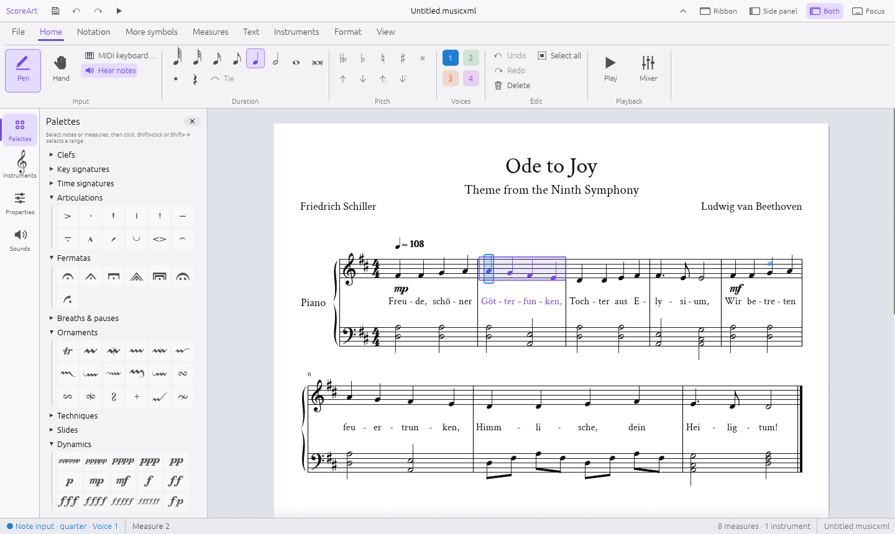
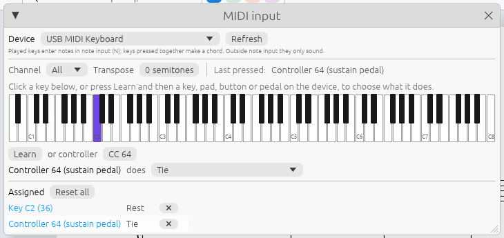

# Writing music

ScoreArt has two tools, shown at the left of the *Home* tab:

- the **pen** (`N`): a click on the staff writes a note where the faint *ghost note* shows;
- the **hand** (`Esc`): a click selects, a drag moves things.

## With the computer keyboard

1. Click the note or rest where you want to start, then press `N`.
2. Choose a **duration**: `1` = 64th, `2` = 32nd, `3` = 16th, `4` = eighth, `5` = quarter,
   `6` = half, `7` = whole, `8` = breve. `.` adds a dot.
3. Type the **note names** `A`–`G`. ScoreArt picks the octave nearest to the previous note and
   applies the key signature. `0` writes a rest.
4. Fix as you go: `↑` / `↓` move the last note a semitone, `Ctrl+↑` / `Ctrl+↓` an octave;
   `Shift+A`–`G` adds a note to the chord; `T` ties it to the next note.

Notes that do not fit the rest of the measure are split and tied over the barline
automatically.

## With the mouse

With the **pen**, click on a line or space to write the note shown by the ghost note. With the
**hand**, drag a note **up or down** to change its pitch, or **sideways** — even into another
measure or staff — to move it to that beat. Its marks and lyrics go along.

## With a MIDI keyboard

*Home → MIDI keyboard…* connects a MIDI keyboard (on the desktop and in Chrome/Edge). Play notes
and chords and they are written at the cursor. Every key and pedal can be given its own job —
a note value, a rest, a tie, undo, play … — by clicking it on the keyboard picture or with
*Learn*.

## Voices

Up to **four voices** per staff — for two melodies on one staff, or a melody over
accompaniment. Pick the voice with the coloured buttons on *Home* (or `Ctrl+Alt+1`…`4`) before
writing.

## Lyrics

Select a note and press `Ctrl+L`, then type its syllable. End a syllable with `-` to join it to
the next one with a hyphen ("Freu-" "de"). The *Properties* tab of the side panel shows the
lyrics of the selected note and the verse you are writing; a note can carry several verses.

## Selecting

Click a note, or click an empty spot of a measure to select the whole measure. `Shift+click`
or `Shift+→` extends the selection to a range. `Del` deletes what is selected.

## Measures

The *Measures* tab adds, inserts and deletes measures, changes **clefs, keys and time
signatures**, sets **barlines and repeats**, and gives a measure its own length — for a
**pickup** (upbeat) or a short ending (*Length / pickup…*).
