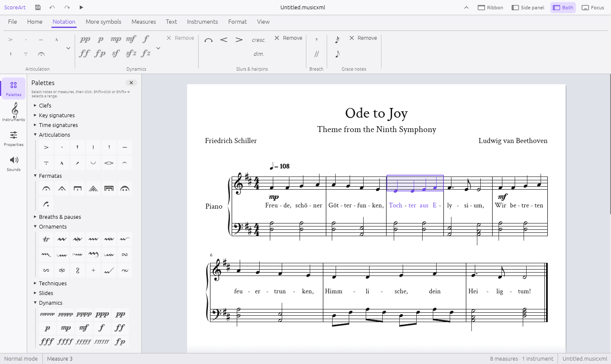
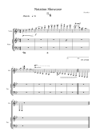

# Marks and lines

Select one or more notes, then click a mark — on the *Notation* tab, on *More symbols*, or in
the *Palettes* of the side panel.

| Kind | Examples |
|---|---|
| **Dynamics** | pppppp … ffffff, sf, sfz, fp, rfz … (30 in all) |
| **Articulation** | staccato, accent, tenuto, marcato, portato … and 7 kinds of **fermata** |
| **Lines** | slurs (`S`), crescendo `<` and diminuendo `>` hairpins, "cresc." lines, 8va / 8vb / 15ma, pedal, trill line, glissando |
| **Ornaments** | trill, mordent, turn and 16 more |
| **Grace notes** | acciaccatura (`/`), appoggiatura, 16th and 32nd — before the note or after it |
| **Repeats and jumps** | repeat barlines, 1st/2nd endings (also "1.+3."), segno, coda, D.C., D.S., Fine, To Coda |
| **More** | tremolos, arpeggios, noteheads (x, diamond, slash …), breath marks, caesuras, bowings, harmonics, jazz slides |

Text that belongs to the music is on the *Text* tab: **chord symbols** (`Ctrl+K`, e.g.
`Cmaj7`, `F#m7/C#`), **staff text** (`Ctrl+T`, e.g. "dolce", "pizz."), **fingering**,
**rehearsal marks** (`Ctrl+M`), **tempo** (♩ = 108, also "Allegro") and system text.

Here is a sample of what ScoreArt draws:

## Moving marks

With the **hand**, drag staff texts, dynamics and lines where you want them. A line can be
dragged as a whole or by one of its ends onto another note; pull the open end of a hairpin up
or down to make it wider. Everything you move is saved.

## Everything is heard

What you write is also played: dynamics and hairpins change the loudness (even on long notes),
fermatas hold, repeats and jumps are followed, trills and tremolos are played out, "rit." and
"accel." slow down and speed up. See [Playback and sounds](07-playback-and-sounds.md).
