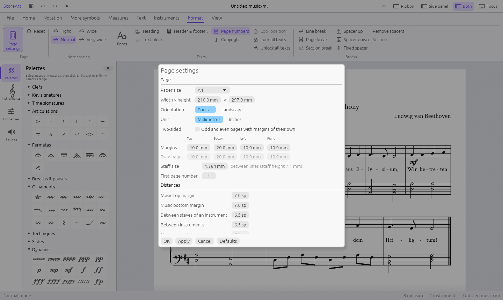
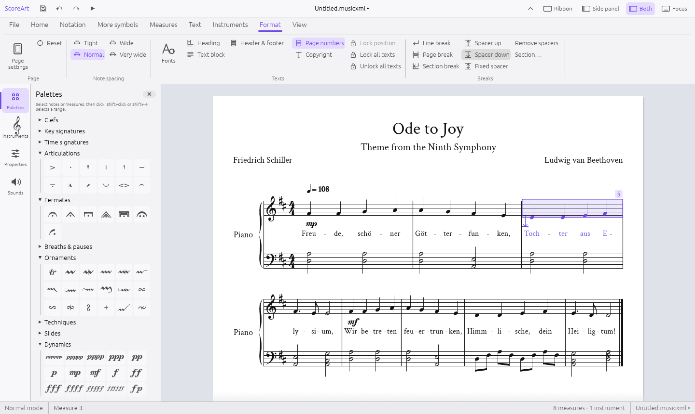
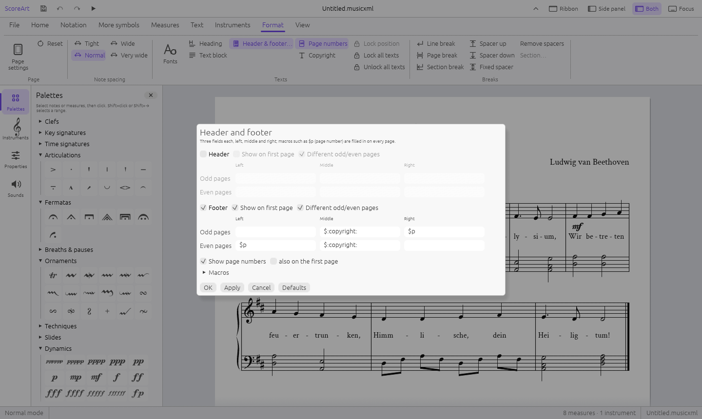

# Pages and layout

ScoreArt lays your music out on pages by itself: it spaces the notes, fills the lines and
starts new pages. The *Format* tab lets you take control where you want to.

## Page settings

*Format → Page settings* sets the **paper size** (A4, Letter, A3 …), portrait or landscape,
millimetres or inches, **margins** (also different ones for odd and even pages), the **staff
size**, the first page number, and the **distances** between staves, instruments and systems.
*Vertical justification* spreads the systems so every page is filled evenly.

A new score starts with the same page settings as a new score in MuseScore 4 (A4, margins of
10 mm, page number and copyright at the bottom).

**Note spacing** (*Tight*, *Normal*, *Wide*, *Very wide*) makes the music denser or airier.

## Breaks and spacers

Select a measure, then on *Format → Breaks* (or *Measures*):

- **Line break** — the next measure starts a new line.
- **Page break** — the next measure starts a new page.
- **Section break** — a new line with the full instrument names, measure numbers starting at 1
  again, and a pause in playback (3 seconds; change it with *Section…*). Use it between the
  movements or songs of one file.
- **Spacer up / down** — more room above or below one staff in these measures, e.g. for high
  notes. A **fixed spacer** sets an exact distance to the staff or system below.

Breaks and spacers show as small violet signs on the screen; they are never printed.

When a line break follows a little more music than fits, ScoreArt moves the notes slightly
closer instead of breaking the line again — so the lines end where you said.

## Headers and footers

*Format → Header & footer…* has a left, middle and right field for the top and the bottom of
the page, separately for odd and even pages if you like. Fields can hold text and
**placeholders** that are filled in on every page:

| Placeholder | Becomes |
|---|---|
| `$p` / `$P` | page number (not on the first page / on every page) |
| `$n` | number of pages |
| `$:workTitle:` `$:composer:` `$:lyricist:` `$:copyright:` | the score's properties |
| `$C` / `$c` | copyright (first page only / every page) |
| `$d` | today's date |
| `$D` | the date the score was created |
| `$M` / `$m` | date / time of the last change |
| `$f` / `$F` | file name / file name with its folder |
| `$$` | a dollar sign |

