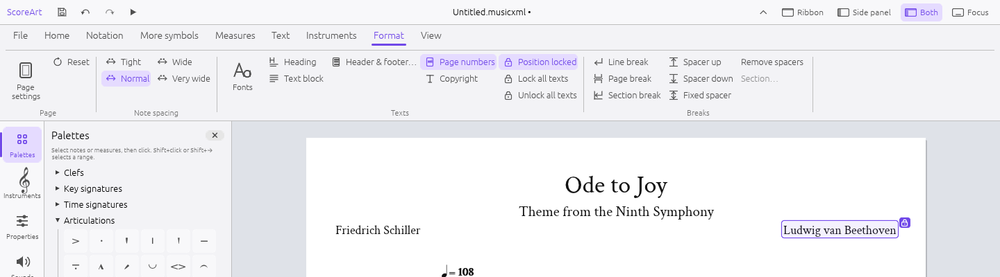
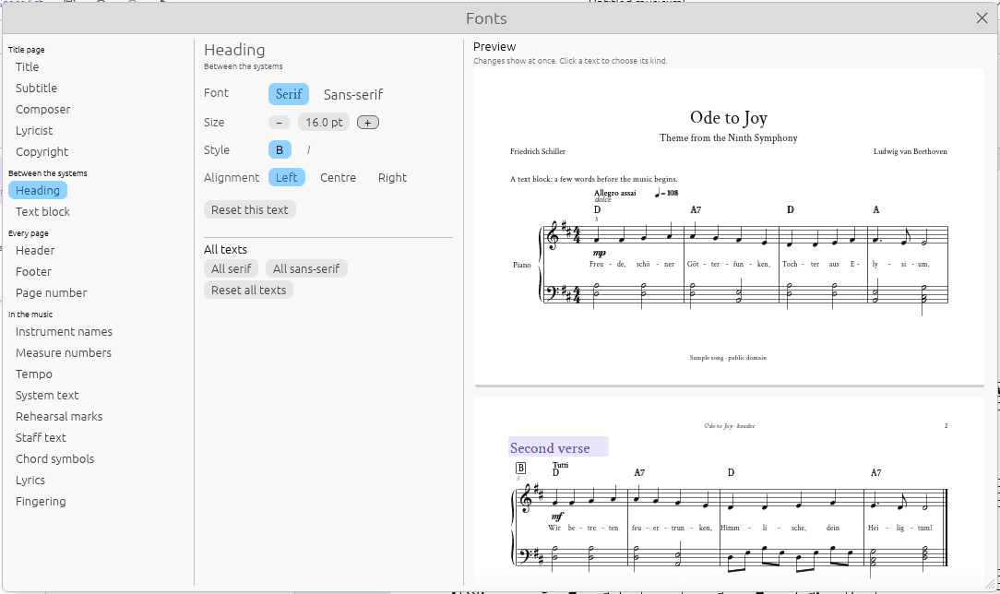

# Texts

## Title page

*Text → Title & credits* sets the **title**, **subtitle**, **composer** and **lyricist**; the
copyright goes to *Format → Copyright*. They are printed at the top of the first page (the
copyright at its foot).

**Headings** and **text blocks** between the lines — for the title of a second song, a poem, a
note to the players — are added with *Format → Heading* or *Text block* above the selected
measure. Double-click any text to edit it; `Del` removes the one you picked.

## Text fields and worksheets

A text block is a **text field** with a look of its own — enough for a worksheet in a music
lesson. In its dialog (double-click it, or add a new one):

- **Own formatting**: font, size, bold, italic, underlined and alignment for this field alone
  (without it the field follows the style of headings or text blocks in *Fonts*);
- **Frame** and **grey background**, for a task or an answer box;
- **Width** in percent of the line; a field narrower than the line stands left, centred or
  right as it is aligned;
- **Lines to write on** below the text — after a short label like "Name:" the first line runs
  on beside it; a field with lines or a frame may have no text at all (an answer box);
- **Beside the field before**: fields stand side by side in one row, e.g. *Name* and *Date*.

Text fields **take room of their own**: the music moves aside and never runs under them. When you
drag a field down, the music below moves along; dragged up, it stops below the system before it.
Overlaps that remain are marked in red (*View → Overlaps*).

## Moving and locking texts

With the **hand**, every text block can be picked up and moved freely.

When a text is where it should be, **lock** it: pick it and click *Format → Lock position*. A
padlock appears, and the text can no longer be dragged by accident. Click the same button
(*Position locked*) to let it move again. *Lock all texts* and *Unlock all texts* do it for
every text block at once. Locks are saved with the score.

## Fonts

*Format → Fonts* lists every kind of text in one place — the title page, headings, headers and
footers, and the texts in the music (instrument names, tempo, lyrics, chord symbols …). For each
you choose the font (serif or sans-serif), size, bold, italic and, for blocks, the alignment. The
**live preview** next to it shows every change at once.

