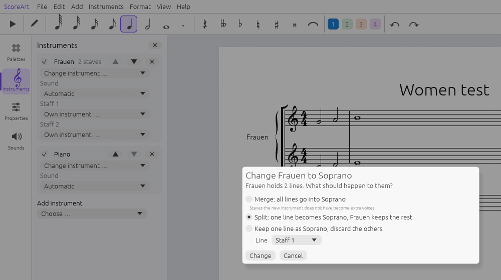

# Instruments

Press `I` (or *Instruments → Instruments*) to open the **Instruments** tab of the side panel.
There you **add**, **rename**, **reorder**, **hide** and **remove** instruments — piano, organ,
voices, choir (women, men, SATB), strings, woodwinds, brass and more.

**Changing** an instrument keeps its music. When an instrument holds several lines — say
*Women* with soprano and alto — and you change it to *Soprano*, ScoreArt asks whether to
**merge** the lines, **split** one off into a new instrument, or **keep only one**.

An **instrument change inside a part** ("To Flute") is a mark on the *Instruments* tab: the
music after it is played with the new sound. *Transpose* moves the selection up or down a
semitone.
