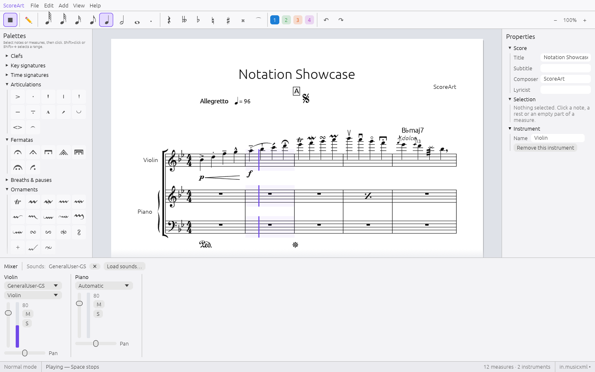
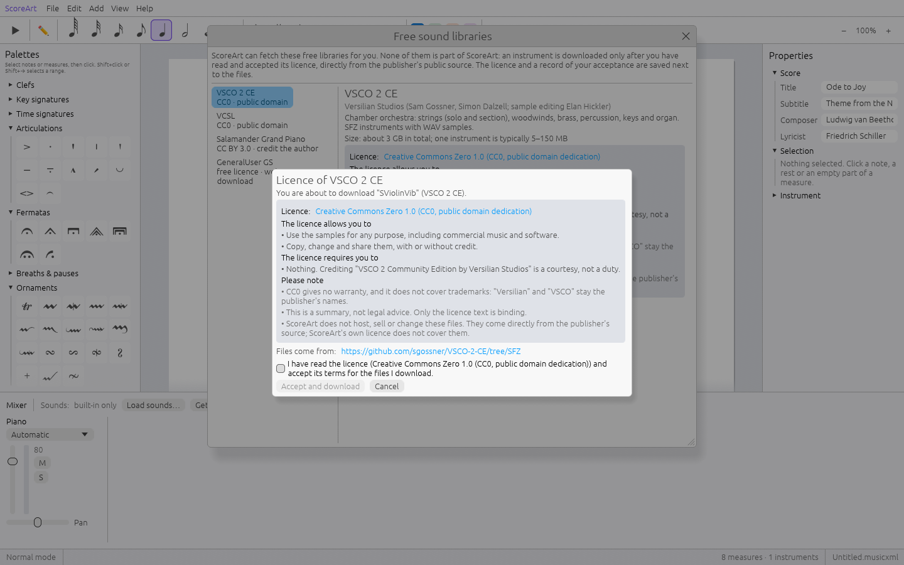

# Playback and sounds

Press **Space** to play from the selected note; press it again (or `Esc`) to stop. A line
follows the music. With *Hear notes* on (*Home*), every note sounds as you write it.

ScoreArt plays what is written: dynamics and hairpins, accents and staccato, slurs, fermatas,
breath marks, repeats and jumps, ornaments and tremolos, tempo changes and swing. Each
instrument family plays in its own way, and each note gets a natural attack and release.
*Instruments → Sound optimization* switches this shaping off if you want plain notes.

## The mixer

**Mixer** (`F10`) gives every instrument its own track: sound, volume, pan, mute, solo and a
level meter. *Room* adds reverb, *Human touch* a little natural unevenness. All of this is saved
with the score.

## Better sounds

The built-in sounds need no download. For real instruments, load a **sample library**:

- *Get free sounds…* downloads free libraries (orchestra, piano …) instrument by instrument or
  all at once. Each library's licence is shown first and must be accepted.
- *Load sounds…* opens a SoundFont (`.sf2`) or SFZ library you already have.

With a good library, the notation chooses the samples: staccato notes play staccato samples,
"pizz." plucks, "con sord." plays muted.

More: [Sounds and libraries](../sounds.md) · [How playback works](../playback.md)

## Audio export

*File → Export* writes **WAV** audio of the whole score, or a **zip with one WAV per
instrument** for mixing elsewhere.
