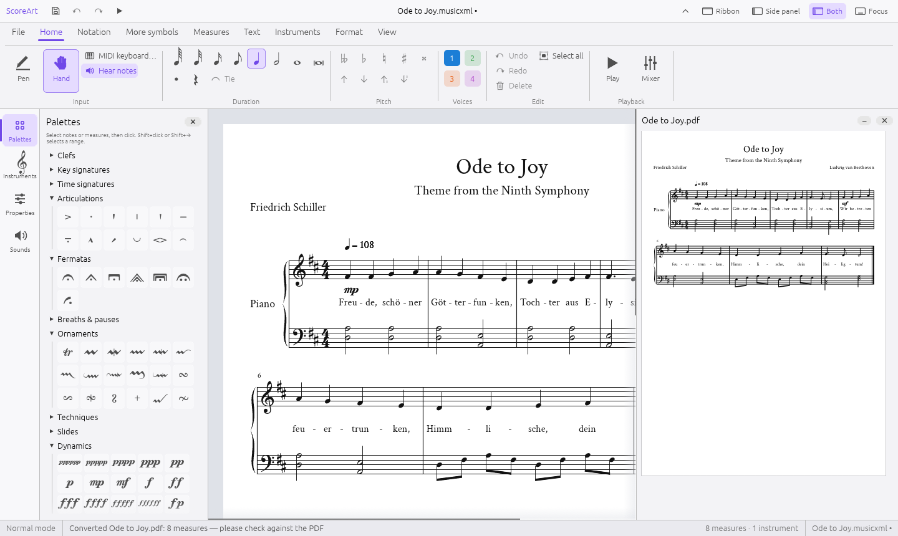

# Files

## Saving

ScoreArt saves **MusicXML** (`.musicxml`, or compressed `.mxl`) — the open format of music
notation. MuseScore, Sibelius, Finale, Dorico and most other programs open it. Your page
settings, texts, fonts, sounds and mixer are saved in it too, and ScoreArt writes where its
lines and pages start, so other programs show your score with the same lines.

## Opening

*File → Open* (`Ctrl+O`), or drop a file on the window. ScoreArt opens:

| File | From |
|---|---|
| `.musicxml`, `.mxl`, `.xml` | MusicXML from any program — Finale, Sibelius, Dorico, MuseScore, Noteflight … |
| `.mscz`, `.mscx` | **MuseScore 2, 3 and 4** directly, with page layout, texts and styles |
| `.mid`, `.midi` | MIDI files; rhythms are tidied to the simplest fitting notes, triplets included |
| `.pdf` | PDFs — shown next to your score, or converted into a score (see below) |

A MuseScore file is saved as MusicXML when you press *Save*; the original stays untouched.

ScoreArt was checked note by note against several hundred files from these programs — see
[File formats and compatibility](../technical/file-formats.md) for what that covered.

## PDFs

When you open a PDF, ScoreArt asks what to do with it:

- **Show next to the score** — the PDF's pages appear in a panel on the right, next to the score
  you are working on. Handy for copying music by hand. *View → PDF* shows or hides the panel.
- **Convert to a score** — ScoreArt reads the music in the PDF and makes an editable score of
  it: instruments, clefs, keys, time signatures, notes and rests, chords, voices, ties, slurs,
  lyrics, dynamics, the title and the composer. The PDF stays open on the right, so you can
  compare. Measures ScoreArt was unsure about are listed at the top of the panel.

Converting works with PDFs that **notation programs wrote** — MuseScore, Sibelius, Finale,
Dorico, LilyPond and ScoreArt itself — because their PDFs still contain the music font's symbols and the
staff lines. **Scanned** sheet music (photos or scans of paper) is just a picture and cannot be
converted yet. Always check the result against the PDF: ScoreArt gets most notes right, but
unusual notation can come out wrong.

## Exporting

*File → Export*:

| Format | For |
|---|---|
| PDF | printing and sharing — every page, with the music font embedded |
| MusicXML / compressed MusicXML | other notation programs |
| MIDI | sequencers and DAWs |
| SVG (first page) | pictures for web pages and documents |
| WAV | listening, sharing |
| WAV per instrument (zip) | mixing in an audio program |
