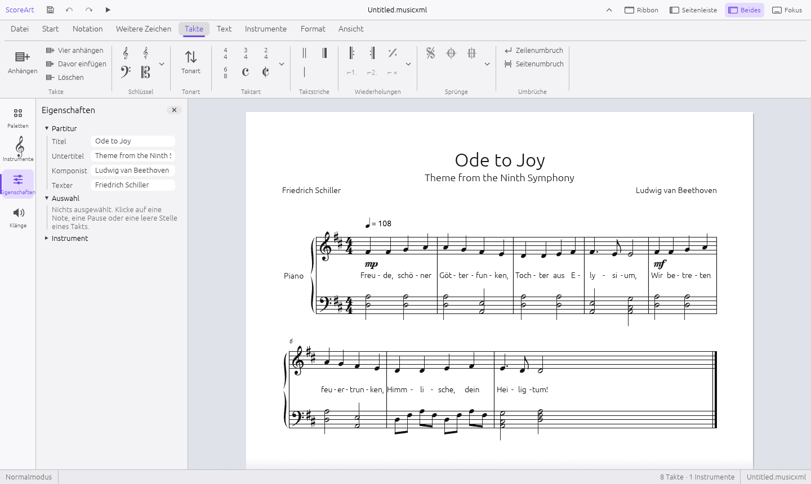

# ScoreArt user guide

Welcome! This guide shows you how to write, print and play music with ScoreArt. No prior
knowledge of notation software is needed — if you can read notes, you can start.

1. [Getting started](01-getting-started.md) — install, the window, your first score
2. [Writing music](02-writing-music.md) — notes, rests, chords, voices, lyrics
3. [Marks and lines](03-marks-and-lines.md) — dynamics, articulation, slurs, repeats, chord symbols
4. [Pages and layout](04-pages-and-layout.md) — paper, margins, breaks, spacing, headers and footers
5. [Texts](05-texts.md) — title, composer, headings, fonts, moving and locking texts
6. [Instruments](06-instruments.md) — adding, changing and arranging instruments
7. [Playback and sounds](07-playback-and-sounds.md) — listening, the mixer, sound libraries
8. [Files](08-files.md) — opening, saving, exporting; MuseScore, Sibelius, Finale, Dorico, MIDI
9. [Keyboard shortcuts](09-keyboard.md)

The interface speaks **English and German** (*View → Language*); this guide uses the English
names. Auf Deutsch: [Handbuch](de/README.md).

