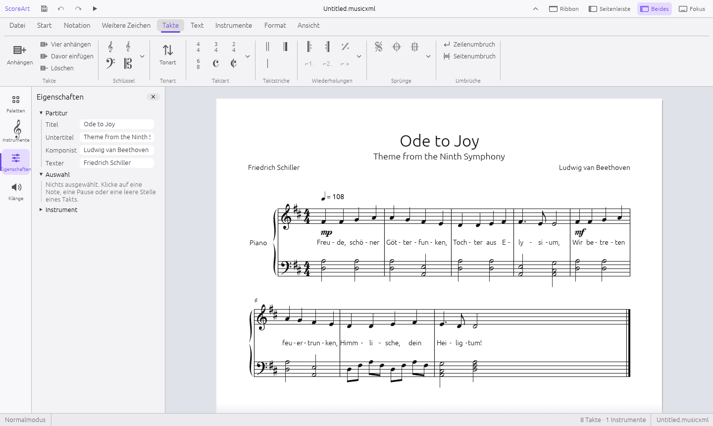
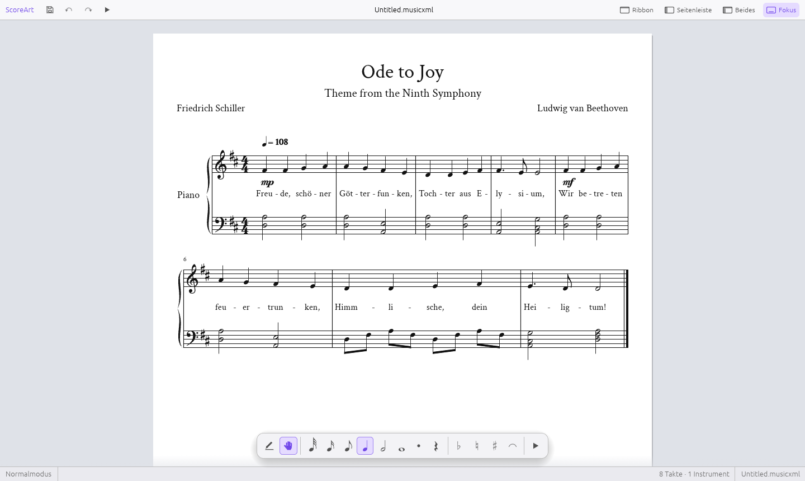

# Erste Schritte

## Installieren

**Ohne Installation:** **https://manueldell.github.io/scoreart/** im Browser öffnen.

Oder lade ScoreArt vom [neuesten Release](https://github.com/ManuelDell/scoreart/releases/latest)
herunter:

| Dein Computer | Download | Dann |
|---|---|---|
| **Windows** | `scoreart-…-windows.zip` | Entpacken und `scoreart.exe` starten. Meldet Windows *„Der Computer wurde durch Windows geschützt“*: *Weitere Informationen → Trotzdem ausführen*. |
| **macOS** (Apple Silicon und Intel) | `scoreart-…-macos.zip` | Entpacken, **ScoreArt.app** in *Programme* ziehen und öffnen. Beim ersten Mal meldet macOS, dass es die App nicht prüfen kann: *Systemeinstellungen → Datenschutz & Sicherheit → Dennoch öffnen*. |
| **Linux** | `scoreart-…-linux.tar.gz` | Entpacken und `./scoreart` starten. |
| **Eigener Webserver** | `scoreart-…-web.zip` | Die Browser-Version zum Selbst-Hosten; sie läuft komplett im Browser. |

Die Warnungen kommen nur, weil ScoreArt nicht mit einem kostenpflichtigen Zertifikat signiert
ist. In jedem Download liegt eine `START-HERE.txt` mit diesen Schritten.

Du kannst ScoreArt auch selbst aus dem Quellcode bauen — siehe die
[README](../../../README.md#for-developers).

## Das Fenster

- **Titelleiste** (oben): Speichern, Rückgängig, Wiederherstellen, Abspielen; der Dateiname;
  und der Wechsel zwischen den vier **Ansichten** — *Ribbon*, *Seitenleiste*, *Beides*
  (Standard) und *Fokus*.
- **Ribbon**: Reiter mit Knöpfen, nach Aufgaben gruppiert. *Start* enthält, was du ständig
  brauchst (Noteneingabe, Notenwerte, Vorzeichen, Stimmen, Wiedergabe); *Notation* und *Weitere
  Zeichen* enthalten die Zeichen; dann folgen *Takte*, *Text*, *Instrumente*, *Format* und
  *Ansicht*. Ein ausgegrauter Knopf kann mit der aktuellen Auswahl nichts anfangen — sein
  Tooltip sagt dir, warum. Ein Doppelklick auf einen Reiter (oder `Strg+F1`) klappt das Ribbon
  ein.
- **Seitenleiste** (links): *Paletten* mit allen Zeichen, *Instrumente*, *Eigenschaften* der
  Auswahl und *Klänge*. Ein Klick auf den offenen Reiter klappt die Leiste ein.
- **Die Partitur** in der Mitte, so wie sie gedruckt wird.
- **Statuszeile** (unten): was ausgewählt ist, der Eingabemodus, die Größe der Partitur.

**Fokus** zeigt nur die Partitur und eine kleine schwebende Leiste — gut zum Schreiben ohne
Ablenkung:

## Deine erste Partitur

1. *Datei → Neue Partitur…* (`Strg+N`).
2. Gib Titel und Komponist ein und wähle die **Instrumente** (Klavier, Gesang, Chor,
   Streicher, Bläser …), die **Taktart**, die **Tonart**, die Zahl der Takte und das Tempo.
3. Klicke auf **Erstellen**. Die leere Partitur erscheint und wartet auf Noten — weiter geht
   es mit [Noten schreiben](02-noten-schreiben.md).

Zum Umschauen öffnet *Datei → Beispiele → Ode an die Freude* das Beispiellied. Drücke die
**Leertaste**, um es zu hören.

## Rückgängig, speichern, zoomen

- **Rückgängig / Wiederherstellen**: `Strg+Z` / `Strg+Y` — so oft du willst.
- **Speichern**: `Strg+S`. ScoreArt speichert MusicXML (`.musicxml`), das jedes
  Notensatzprogramm öffnen kann. Siehe [Dateien](08-dateien.md).
- **Zoom**: `Strg +` / `Strg −` oder *Ansicht → Zoom*. Unter *Ansicht* wechselst du außerdem
  zwischen **Seitenansicht**, **durchgehender Ansicht** (eine endlose Zeile) und einer
  vertikalen Ansicht.
