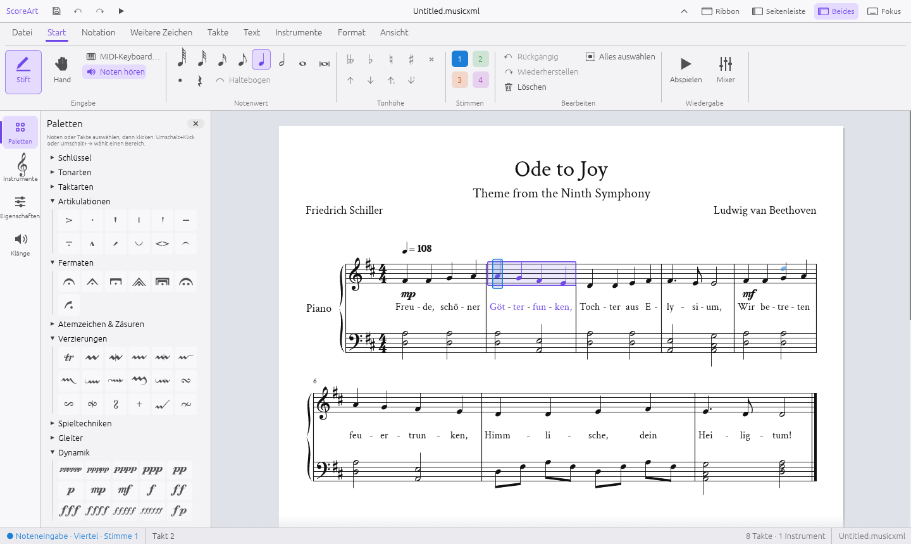

# Noten schreiben

ScoreArt hat zwei Werkzeuge, links im Reiter *Start*:

- den **Stift** (`N`): Ein Klick ins Notensystem schreibt eine Note dort, wo die blasse
  *Geisternote* zu sehen ist;
- die **Hand** (`Esc`): Ein Klick wählt aus, Ziehen verschiebt.

## Mit der Computertastatur

1. Klicke die Note oder Pause an, bei der du beginnen willst, und drücke `N`.
2. Wähle den **Notenwert**: `1` = 64tel, `2` = 32tel, `3` = 16tel, `4` = Achtel,
   `5` = Viertel, `6` = Halbe, `7` = Ganze, `8` = Brevis. `.` fügt einen Punkt hinzu.
3. Tippe die **Notennamen** `A`–`G` (das deutsche H ist `B`). ScoreArt wählt die Oktave, die
   der vorigen Note am nächsten liegt, und berücksichtigt die Tonart. `0` schreibt eine Pause.
4. Korrigiere direkt: `↑` / `↓` verschieben die letzte Note um einen Halbton, `Strg+↑` /
   `Strg+↓` um eine Oktave; `Umschalt+A`–`G` fügt dem Akkord eine Note hinzu; `T` bindet sie
   an die nächste Note.

Noten, die nicht mehr in den Takt passen, werden automatisch geteilt und über den Taktstrich
gebunden.

## Mit der Maus

Mit dem **Stift** klickst du auf eine Linie oder einen Zwischenraum, um die Note der
Geisternote zu schreiben. Mit der **Hand** ziehst du eine Note **nach oben oder unten**, um die
Tonhöhe zu ändern, oder **seitlich** — sogar in einen anderen Takt oder ein anderes System —,
um sie auf diesen Schlag zu verschieben. Ihre Zeichen und ihr Liedtext wandern mit.

## Mit einem MIDI-Keyboard

*Start → MIDI-Keyboard…* verbindet ein MIDI-Keyboard (am Desktop und in Chrome/Edge). Spiele
Noten und Akkorde, und sie werden an der Eingabestelle geschrieben. Jede Taste und jedes Pedal
kann eine eigene Aufgabe bekommen — einen Notenwert, eine Pause, einen Haltebogen, Rückgängig,
Abspielen … —, indem du sie auf dem Tastaturbild anklickst oder mit *Lernen* belegst.

## Stimmen

Bis zu **vier Stimmen** pro System — für zwei Melodien auf einem System oder eine Melodie über
einer Begleitung. Wähle die Stimme vor dem Schreiben mit den farbigen Knöpfen unter *Start*
(oder `Strg+Alt+1`…`4`).

## Liedtext

Wähle eine Note und drücke `Strg+L`, dann tippe ihre Silbe. Endet eine Silbe mit `-`, wird sie
mit einem Bindestrich an die nächste angeschlossen („Freu-“ „de“). Der Reiter *Eigenschaften*
der Seitenleiste zeigt den Liedtext der gewählten Note und die Strophe, an der du schreibst;
eine Note kann mehrere Strophen tragen.

## Auswählen

Klicke eine Note an, oder klicke auf eine freie Stelle in einem Takt, um den ganzen Takt zu
wählen. `Umschalt+Klick` oder `Umschalt+→` erweitert die Auswahl zu einem Bereich. `Entf`
löscht die Auswahl.

## Takte

Im Reiter *Takte* fügst du Takte an, ein oder löschst sie, änderst **Schlüssel, Tonarten und
Taktarten**, setzt **Taktstriche und Wiederholungen** und gibst einem Takt eine eigene Länge —
für einen **Auftakt** oder einen kurzen Schluss (*Länge / Auftakt…*).
