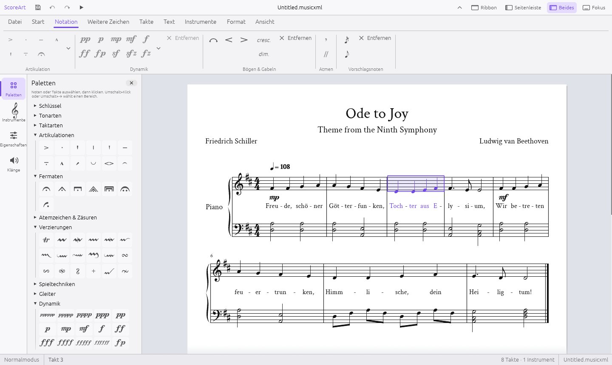
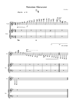

# Zeichen und Linien

Wähle eine oder mehrere Noten aus und klicke dann ein Zeichen an — im Reiter *Notation*, unter
*Weitere Zeichen* oder in den *Paletten* der Seitenleiste.

| Art | Beispiele |
|---|---|
| **Dynamik** | pppppp … ffffff, sf, sfz, fp, rfz … (30 insgesamt) |
| **Artikulation** | Staccato, Akzent, Tenuto, Marcato, Portato … und 7 Arten von **Fermaten** |
| **Linien** | Bindebögen (`S`), Crescendo- `<` und Decrescendo-Gabeln `>`, „cresc.“-Linien, 8va / 8vb / 15ma, Pedal, Trillerlinie, Glissando |
| **Verzierungen** | Triller, Mordent, Doppelschlag und 16 weitere |
| **Vorschlagsnoten** | kurzer Vorschlag (`/`), langer Vorschlag, 16tel und 32tel — vor der Note oder danach (Nachschlag) |
| **Wiederholungen und Sprünge** | Wiederholungsstriche, 1./2. Haus (auch „1.+3.“), Segno, Coda, D.C., D.S., Fine, To Coda |
| **Weiteres** | Tremolos, Arpeggios, Notenköpfe (x, Raute, Schrägstrich …), Atemzeichen, Zäsuren, Bogenstriche, Flageoletts, Jazz-Glissandi |

Text, der zur Musik gehört, steht im Reiter *Text*: **Akkordsymbole** (`Strg+K`, z. B.
`Cmaj7`, `F#m7/C#`), **Systemtext** (`Strg+T`, z. B. „dolce“, „pizz.“), **Fingersatz**,
**Studierzeichen** (`Strg+M`), **Tempo** (♩ = 108, auch „Allegro“) und Akkoladentext.

So sieht ein Ausschnitt dessen aus, was ScoreArt setzt:

## Zeichen verschieben

Mit der **Hand** ziehst du Systemtexte, Dynamik und Linien dorthin, wo du sie haben willst.
Eine Linie lässt sich als Ganzes ziehen oder an einem Ende auf eine andere Note; zieh das
offene Ende einer Gabel nach oben oder unten, um sie weiter zu öffnen. Alles, was du
verschiebst, wird gespeichert.

## Alles ist zu hören

Was du schreibst, wird auch gespielt: Dynamik und Gabeln ändern die Lautstärke (sogar auf
langen Noten), Fermaten halten an, Wiederholungen und Sprünge werden befolgt, Triller und
Tremolos ausgespielt, „rit.“ und „accel.“ werden langsamer und schneller. Siehe
[Wiedergabe und Klänge](07-wiedergabe-und-klaenge.md).
