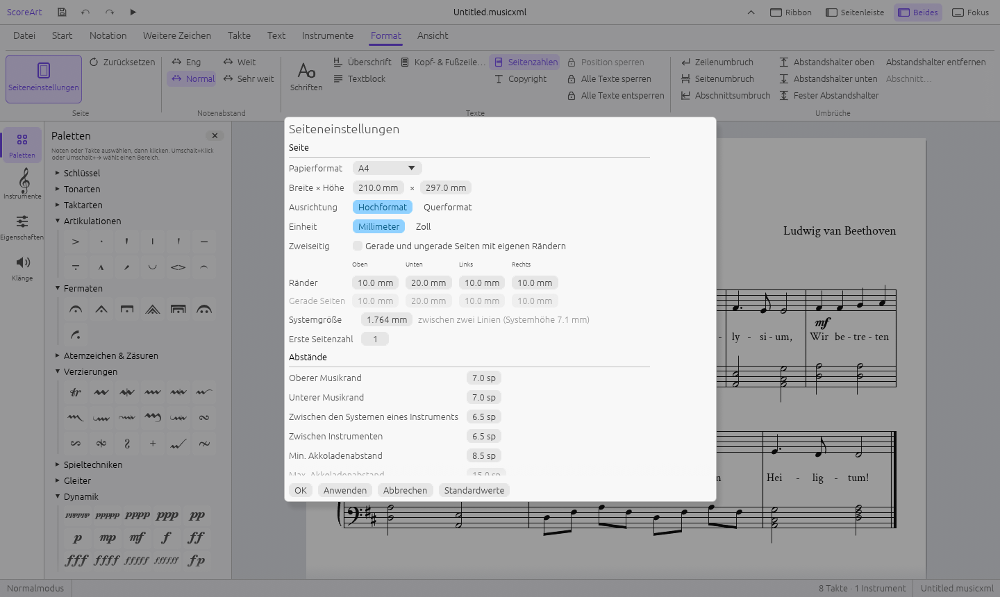
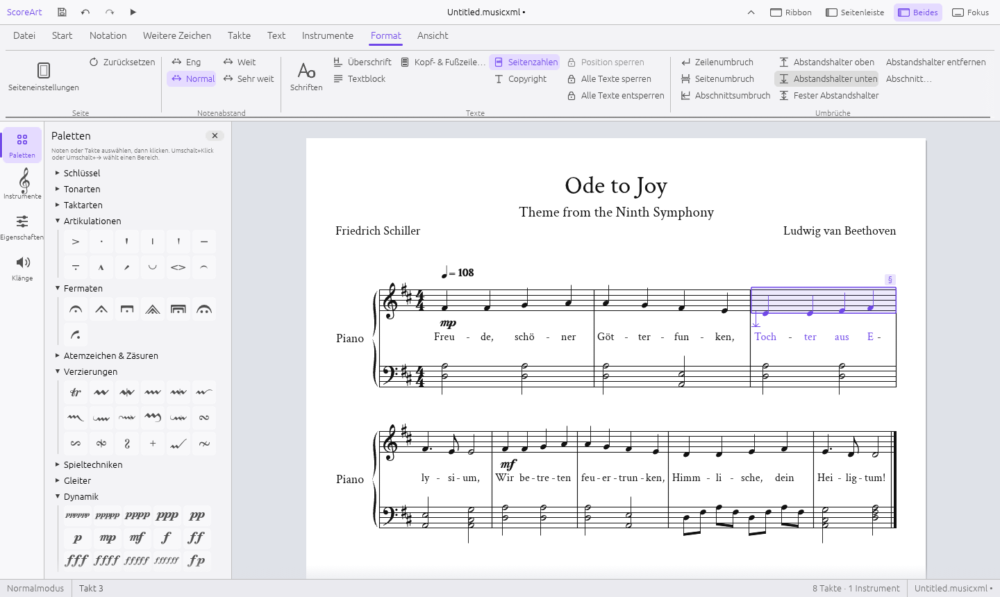
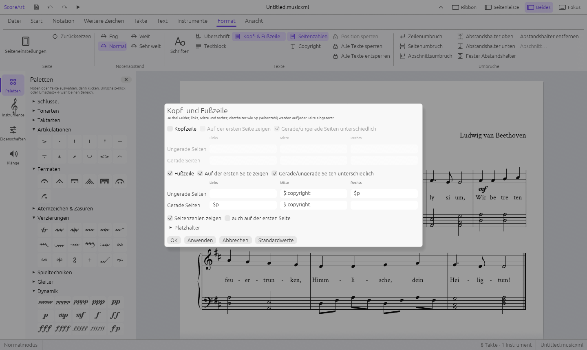

# Seiten und Layout

ScoreArt verteilt deine Musik selbstständig auf die Seiten: Es setzt die Notenabstände, füllt
die Zeilen und beginnt neue Seiten. Im Reiter *Format* übernimmst du die Kontrolle, wo du
möchtest.

## Seiteneinstellungen

*Format → Seiteneinstellungen* legt das **Papierformat** fest (A4, Letter, A3 …), Hoch- oder
Querformat, Millimeter oder Zoll, die **Ränder** (auf Wunsch unterschiedlich für gerade und
ungerade Seiten), die **Systemgröße**, die erste Seitenzahl und die **Abstände** zwischen
Systemen, Instrumenten und Akkoladen. *Vertikal ausrichten* verteilt die Akkoladen so, dass
jede Seite gleichmäßig gefüllt ist.

Eine neue Partitur beginnt mit denselben Seiteneinstellungen wie eine neue Partitur in
MuseScore 4 (A4, Ränder von 10 mm, Seitenzahl und Copyright unten).

Der **Notenabstand** (*Eng*, *Normal*, *Weit*, *Sehr weit*) macht die Musik dichter oder
luftiger.

Ebenfalls in den Seiteneinstellungen: die **Instrumentnamen** vor dem ersten und vor den
weiteren Systemen (voll, kurz oder keine), ob ein **einzelnes Instrument** benannt wird, und
**deutsche Notennamen** für Akkordsymbole (H statt B, B statt Bb).

## Umbrüche und Abstandshalter

Wähle einen Takt, dann unter *Format → Umbrüche* (oder *Takte*):

- **Zeilenumbruch** — der nächste Takt beginnt eine neue Zeile.
- **Seitenumbruch** — der nächste Takt beginnt eine neue Seite.
- **Abschnittsumbruch** — eine neue Zeile mit den vollen Instrumentennamen, Taktnummern ab 1
  und eine Pause bei der Wiedergabe (3 Sekunden; änderbar unter *Abschnitt…*). Nutze ihn
  zwischen den Sätzen oder Liedern einer Datei.
- **Abstandshalter oben / unten** — mehr Platz über oder unter einem System in diesen Takten,
  etwa für hohe Noten. Ein **fester Abstandshalter** setzt einen genauen Abstand zum System
  bzw. zur Akkolade darunter.
- **Freiraum…** — freier Platz in wählbarer Höhe nach dem System, das mit dem Takt endet (ein
  leerer Rahmen wie in MuseScore): Er schiebt das Folgende nach unten oder auf die nächste Seite.

Umbrüche und Abstandshalter erscheinen als kleine violette Zeichen auf dem Bildschirm; gedruckt
werden sie nie.

Steht vor einem Zeilenumbruch etwas mehr Musik, als in die Zeile passt, rückt ScoreArt die
Noten etwas zusammen, statt die Zeile noch einmal zu teilen — so enden die Zeilen dort, wo du
es willst.

## Überschneidungen

Wo Texte, Liedtext, Akkordsymbole, Studierzeichen, Dynamik oder Noten ineinanderlaufen, markiert
ScoreArt beide **rot**, und die Statusleiste zählt sie („⚠ 3 Überschneidungen“) — so geht eine
gedrängte Stelle vor dem Drucken nicht unter. Die Markierung gibt es nur am Bildschirm, gedruckt
wird sie nie. *Ansicht → Überschneidungen* (oder ein Klick auf die Zahl) schaltet sie aus und
ein; ScoreArt merkt sich die Wahl.

## Kopf- und Fußzeilen

*Format → Kopf- & Fußzeile…* hat ein linkes, mittleres und rechtes Feld für den oberen und
unteren Seitenrand, auf Wunsch getrennt für gerade und ungerade Seiten. Die Felder können Text
und **Platzhalter** enthalten, die auf jeder Seite ausgefüllt werden:

| Platzhalter | Wird zu |
|---|---|
| `$p` / `$P` | Seitenzahl (nicht auf der ersten Seite / auf jeder Seite) |
| `$n` | Anzahl der Seiten |
| `$:workTitle:` `$:composer:` `$:lyricist:` `$:copyright:` | die Angaben der Partitur |
| `$C` / `$c` | Copyright (nur erste Seite / jede Seite) |
| `$d` | heutiges Datum |
| `$D` | Erstellungsdatum der Partitur |
| `$M` / `$m` | Datum / Uhrzeit der letzten Änderung |
| `$f` / `$F` | Dateiname / Dateiname mit Ordner |
| `$$` | ein Dollarzeichen |

