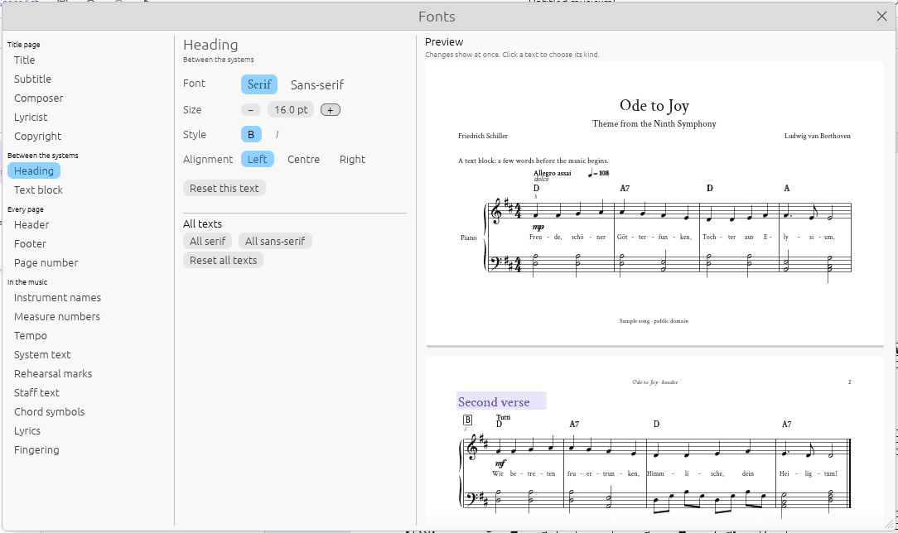

# Texte

## Titelseite

*Text → Titel & Angaben* setzt **Titel**, **Untertitel**, **Komponist** und **Texter**; das
Copyright findest du unter *Format → Copyright*. Sie werden oben auf der ersten Seite gedruckt
(das Copyright an ihrem Fuß).

**Überschriften** und **Textblöcke** zwischen den Zeilen — für den Titel eines zweiten Lieds,
ein Gedicht, einen Hinweis an die Spieler — fügst du mit *Format → Überschrift* oder
*Textblock* über dem gewählten Takt ein. Ein Doppelklick auf einen Text bearbeitet ihn; `Entf`
entfernt den gewählten.

## Textfelder und Arbeitsblätter

Ein Textblock ist ein **Textfeld** mit eigenem Aussehen — genug für ein Arbeitsblatt im
Musikunterricht. Im Dialog (Doppelklick auf das Feld oder beim Anlegen):

- **Eigene Formatierung**: Schrift, Größe, fett, kursiv, unterstrichen und Ausrichtung nur für
  dieses Feld (ohne sie folgt das Feld dem Stil für Überschriften oder Textblöcke unter
  *Schriften*);
- **Rahmen** und **grauer Hintergrund**, für eine Aufgabe oder ein Antwortfeld;
- **Breite** in Prozent der Zeile; ein schmaleres Feld steht links, mittig oder rechts, je nach
  Ausrichtung;
- **Schreiblinien** unter dem Text — nach einer kurzen Beschriftung wie „Name:“ läuft die erste
  Linie gleich daneben weiter; ein Feld mit Linien oder Rahmen darf ganz ohne Text sein (ein
  Antwortfeld);
- **Neben dem Feld davor**: Felder stehen nebeneinander in einer Zeile, z. B. *Name* und *Datum*.

Textfelder **bekommen eigenen Platz**: Die Noten weichen aus und laufen nie darunter. Ziehst du
ein Feld nach unten, wandern die Noten darunter mit; nach oben hält es unter dem System davor an.
Was sich doch überschneidet, wird rot markiert (*Ansicht → Überschneidungen*).

## Texte verschieben und sperren

Mit der **Hand** lässt sich jeder Textblock aufnehmen und frei verschieben.

Steht ein Text, wo er hingehört, **sperre** ihn: wähle ihn an und klicke *Format → Position
sperren*. Ein Schloss erscheint, und der Text lässt sich nicht mehr versehentlich verschieben.
Ein Klick auf denselben Knopf (*Position gesperrt*) gibt ihn wieder frei. *Alle Texte
sperren* und *Alle Texte entsperren* tun das für alle Textblöcke auf einmal. Die Sperren
werden mit der Partitur gespeichert.

## Schriften

*Format → Schriften* zeigt jede Textart an einem Ort — Titelseite, Überschriften, Kopf- und
Fußzeilen und die Texte in der Musik (Instrumentennamen, Tempo, Liedtext, Akkordsymbole …). Für
jede wählst du Schrift (mit oder ohne Serifen), Größe, fett, kursiv und bei Blöcken die
Ausrichtung. Die **Live-Vorschau** daneben zeigt jede Änderung sofort.

