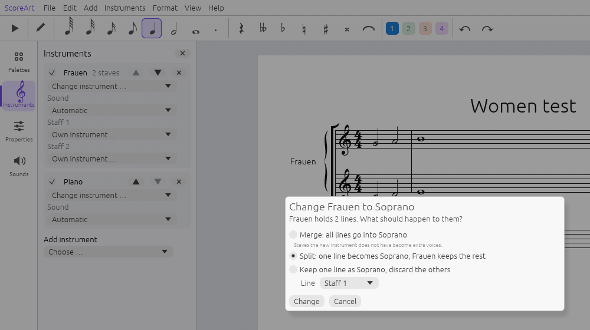

# Instrumente

Drücke `I` (oder *Instrumente → Instrumente*), um den Reiter **Instrumente** der Seitenleiste
zu öffnen. Dort **fügst** du Instrumente **hinzu**, **benennst** sie **um**, **ordnest** sie,
**blendest** sie **aus** oder **entfernst** sie — Klavier, Orgel, Gesang, Chor (Frauen-,
Männer-, gemischter Chor), Streicher, Holz- und Blechbläser und mehr.

Beim **Wechseln** eines Instruments bleibt seine Musik erhalten. Enthält ein Instrument
mehrere Stimmen — etwa *Frauen* mit Sopran und Alt — und du wechselst zu *Sopran*, fragt
ScoreArt, ob die Stimmen **zusammengeführt**, eine davon als neues Instrument **abgetrennt**
oder **nur eine behalten** werden soll.

**Leere Notenzeilen ausblenden** lässt ein Instrument in jedem System weg, in dem es nichts zu
spielen hat — eine Chorstimme, die nur den Refrain singt, erscheint nur dort. Partituren aus
MuseScore behalten diese Einstellung.

Ein **Instrumentenwechsel innerhalb einer Stimme** („To Flute“) ist ein Zeichen im Reiter
*Instrumente*: Die Musik danach klingt mit dem neuen Instrument. *Transponieren* verschiebt die
Auswahl um einen Halbton nach oben oder unten.
