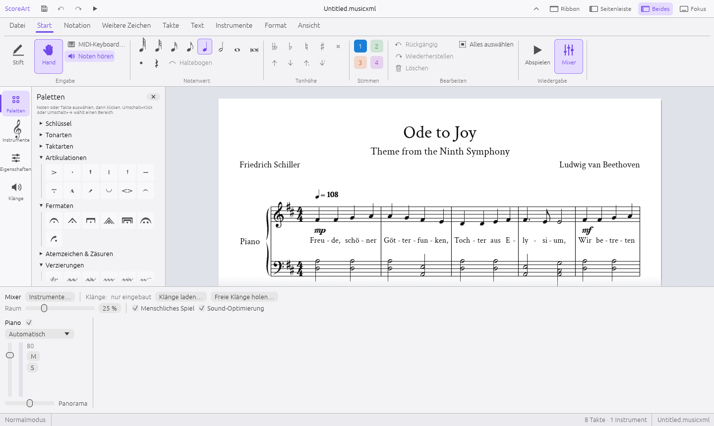

# Wiedergabe und Klänge

Drücke die **Leertaste**, um ab der gewählten Note abzuspielen; noch einmal (oder `Esc`) hält
an. Eine Linie folgt der Musik. Ist *Noten hören* (*Start*) eingeschaltet, erklingt jede Note
schon beim Schreiben.

ScoreArt spielt, was dasteht: Dynamik und Gabeln, Akzente und Staccato, Bindebögen, Fermaten,
Atemzeichen, Wiederholungen und Sprünge, Verzierungen und Tremolos, Tempowechsel und Swing.
Jede Instrumentenfamilie spielt auf ihre Weise, und jede Note bekommt einen natürlichen Einsatz
und ein natürliches Ende. *Instrumente → Sound-Optimierung* schaltet diese Formung ab, wenn du
schlichte Töne möchtest.

## Akkordsymbole

Auch Akkordsymbole erklingen: jedes von seiner Stelle bis zum nächsten, als Basston mit dem
Akkord darüber — „C“, „Am7“, „F#/E“, „Bbmaj7“, „Dsus4“, „G7(b9)“, deutsch „Hm“ und die
übrigen üblichen Schreibweisen; „N.C.“ ist Stille. Im Reiter *Instrumente* hat jedes
Instrument mit Akkordsymbolen **Akkordsymbole abspielen**, das **Instrument**, mit dem sie
klingen (Klavier, Gitarre, Orgel …), und ihre **Lautstärke** — wie der Akkord-Kanal in
MuseScore. Partituren aus MuseScore behalten das dort gewählte Instrument.

## Der Mixer

**Mixer** (`F10`) gibt jedem Instrument eine eigene Spur: Klang, Lautstärke, Panorama, Stumm,
Solo und eine Pegelanzeige. *Raum* fügt Hall hinzu, *Menschliches Spiel* ein wenig natürliche
Ungleichmäßigkeit. Alles wird mit der Partitur gespeichert.

## Bessere Klänge

Die eingebauten Klänge brauchen keinen Download. Für echte Instrumente lädst du eine
**Klangbibliothek**:

- *Freie Klänge holen…* lädt freie Bibliotheken (Orchester, Klavier …) instrumentweise oder
  komplett herunter. Die Lizenz jeder Bibliothek wird zuerst gezeigt und muss bestätigt werden.
- *Klänge laden…* öffnet eine SoundFont- (`.sf2`) oder SFZ-Bibliothek, die du schon hast.

Mit einer guten Bibliothek wählt die Notation die Samples: Staccato-Noten spielen
Staccato-Samples, „pizz.“ zupft, „con sord.“ klingt gedämpft.

Mehr dazu (englisch): [Klänge und Bibliotheken](../../sounds.md) ·
[So funktioniert die Wiedergabe](../../playback.md)

## Audio exportieren

*Datei → Exportieren* schreibt **WAV**-Audio der ganzen Partitur oder ein **Zip mit einer WAV
pro Instrument** zum Weitermischen in einem Audioprogramm.
