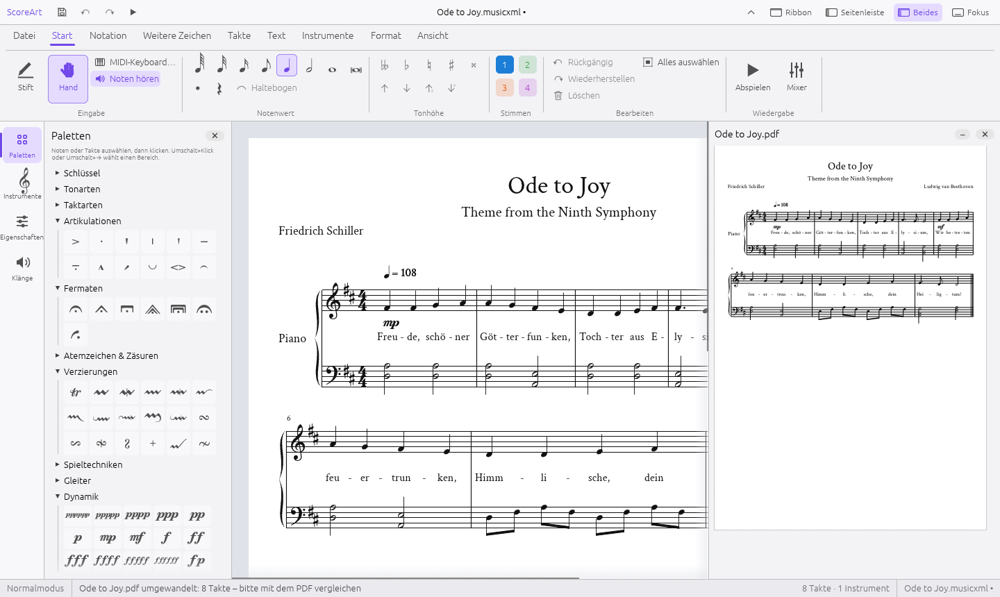

# Dateien

## Speichern

ScoreArt speichert **MusicXML** (`.musicxml` oder komprimiert `.mxl`) — das offene Format für
Notensatz. MuseScore, Sibelius, Finale, Dorico und die meisten anderen Programme öffnen es.
Seiteneinstellungen, Texte, Schriften, Klänge und Mixer werden darin mitgespeichert, und
ScoreArt schreibt hinein, wo seine Zeilen und Seiten beginnen — so zeigen andere Programme
deine Partitur mit denselben Zeilen.

## Öffnen

*Datei → Öffnen…* (`Strg+O`) oder eine Datei aufs Fenster ziehen. ScoreArt öffnet:

| Datei | Von |
|---|---|
| `.musicxml`, `.mxl`, `.xml` | MusicXML aus jedem Programm — Finale, Sibelius, Dorico, MuseScore, Noteflight … |
| `.mscz`, `.mscx` | **MuseScore 2, 3 und 4** direkt, mit Seitenlayout, Texten und Stilen |
| `.mid`, `.midi` | MIDI-Dateien; Rhythmen werden auf die einfachsten passenden Notenwerte gebracht, Triolen eingeschlossen |
| `.pdf` | PDFs — neben der Partitur angezeigt oder in eine Partitur umgewandelt (siehe unten) |

Eine MuseScore-Datei wird beim *Speichern* als MusicXML gesichert; das Original bleibt
unverändert.

ScoreArt wurde Note für Note an mehreren hundert Dateien dieser Programme geprüft — Details
(englisch) unter [Dateiformate und Kompatibilität](../../technical/file-formats.md).

## PDFs

Wenn du ein PDF öffnest, fragt ScoreArt, was damit geschehen soll:

- **Neben der Partitur anzeigen** — die Seiten des PDFs erscheinen rechts neben der Partitur,
  an der du arbeitest. Praktisch zum Abschreiben. *Ansicht → PDF* blendet die Leiste ein und aus.
- **In eine Partitur umwandeln** — ScoreArt liest die Noten im PDF und macht daraus eine
  Partitur, die du bearbeiten kannst: Instrumente, Schlüssel, Tonarten, Taktarten, Noten und
  Pausen, Akkorde, Stimmen, Haltebögen, Bindebögen, Liedtext, Dynamik, Titel und Komponist.
  Das PDF bleibt rechts offen, damit du vergleichen kannst. Takte, bei denen ScoreArt unsicher
  war, stehen oben in der Leiste.

Das Umwandeln klappt mit PDFs, die **Notenprogramme erzeugt** haben — MuseScore, Sibelius,
Finale, Dorico, LilyPond und ScoreArt selbst —, denn in diesen PDFs stecken noch die Zeichen der
Notenschrift und die Notenlinien. **Eingescannte** Noten (Fotos oder Scans von Papier) sind
nur ein Bild und lassen sich noch nicht umwandeln. Vergleiche das Ergebnis immer mit dem PDF:
ScoreArt erkennt die meisten Noten richtig, ungewöhnliche Notation kann aber falsch herauskommen.

## Exportieren

*Datei → Exportieren*:

| Format | Wofür |
|---|---|
| PDF | drucken und weitergeben — alle Seiten, mit eingebetteter Notenschrift |
| MusicXML / komprimiertes MusicXML | andere Notensatzprogramme |
| MIDI | Sequenzer und DAWs |
| SVG (erste Seite) | Bilder für Webseiten und Dokumente |
| WAV | anhören, weitergeben |
| WAV pro Instrument (Zip) | Abmischen in einem Audioprogramm |
