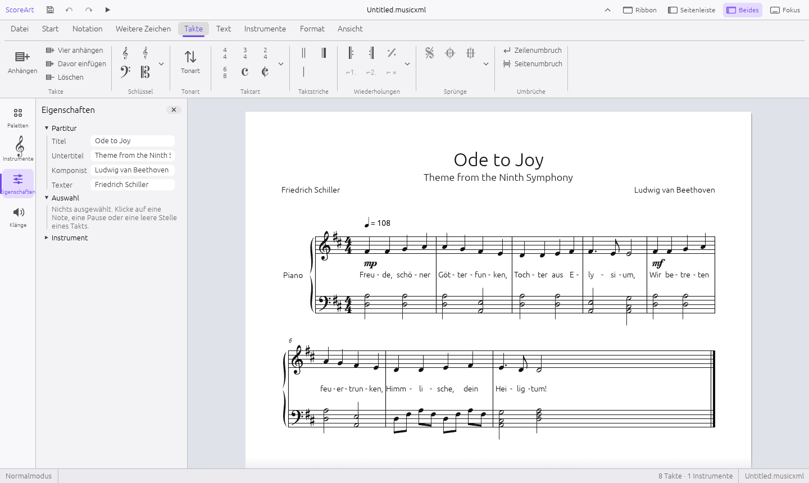

# ScoreArt-Handbuch

Willkommen! Dieses Handbuch zeigt dir, wie du mit ScoreArt Noten schreibst, druckst und
anhörst. Du brauchst keine Vorkenntnisse mit Notensatzprogrammen — wenn du Noten lesen kannst,
kannst du loslegen.

1. [Erste Schritte](01-erste-schritte.md) — installieren, das Fenster, deine erste Partitur
2. [Noten schreiben](02-noten-schreiben.md) — Noten, Pausen, Akkorde, Stimmen, Liedtext
3. [Zeichen und Linien](03-zeichen-und-linien.md) — Dynamik, Artikulation, Bögen, Wiederholungen, Akkordsymbole
4. [Seiten und Layout](04-seiten-und-layout.md) — Papier, Ränder, Umbrüche, Abstände, Kopf- und Fußzeilen
5. [Texte](05-texte.md) — Titel, Komponist, Überschriften, Schriften, Texte verschieben und sperren
6. [Instrumente](06-instrumente.md) — Instrumente hinzufügen, wechseln und anordnen
7. [Wiedergabe und Klänge](07-wiedergabe-und-klaenge.md) — anhören, der Mixer, Klangbibliotheken
8. [Dateien](08-dateien.md) — öffnen, speichern, exportieren; MuseScore, Sibelius, Finale, Dorico, MIDI
9. [Tastenkürzel](09-tastenkuerzel.md)

Die Oberfläche gibt es auf **Deutsch und Englisch** (*Ansicht → Sprache*). Beim ersten Start
übernimmt ScoreArt die Sprache deines Systems bzw. Browsers. Dieses Handbuch verwendet die
deutschen Namen; die englische Fassung findest du [hier](../README.md).

