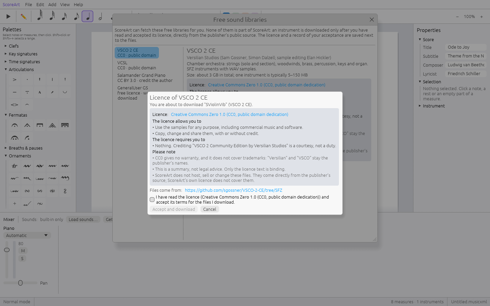

# Sounds: sample playback and the mixer

ScoreArt plays every instrument on its own mixer track. A track sounds with one of:

- the **built-in synthesizer**, the default. It generates every sound in code, so it needs no
  download;
- a **SoundFont 2** preset (`.sf2`), played by [`rustysynth`](https://github.com/sinshu/rustysynth)
  (MIT);
- an **SFZ** sample instrument (`.sfz` with WAV or FLAC samples), played by ScoreArt's own SFZ
  sampler. It is written from the public format description at [sfzformat.com](https://sfzformat.com).

ScoreArt ships **no sample library**. Get one in either of these ways; the mixer is under
*View → Mixer* or <kbd>F10</kbd>:

- **From the catalogue:** *Mixer → Get free sounds…* (or *View → Free sound libraries…*) — see
  [below](#the-catalogue-downloads-with-explicit-licence-acceptance);
- **Your own files:** *Mixer → Load sounds…*.

- **Desktop**: load a `.sf2`, an `.sfz`, a zip, or a whole folder of SFZ instruments. You can
  also drop these files on the window. The desktop app remembers them for the next start.
- **Browser**: load a `.sf2`, or an SFZ library packed as a `.zip` with its samples. Browsers
  cannot open folders.
- **Command line**: add `--sounds PATH` (repeatable), e.g.
  `scoreart-cli convert score.musicxml out.wav --sounds GeneralUser-GS.sf2`.

## The catalogue: downloads with explicit licence acceptance

The *Free sound libraries* window lists VSCO 2 CE, VCSL, the Salamander Grand Piano and
GeneralUser GS. For every library it shows:

- the publisher, the size and the source;
- the licence with a link to the full licence text;
- in plain words what the licence **allows**, what it **requires** (e.g. credit for CC BY), and
  what to note (no warranty, trademarks);
- that the summary is not legal advice;
- that ScoreArt does not host the files.

Downloading works like this:

1. You tick **the instruments you want** (e.g. "SViolinVib"; *Select all* ticks everything not
   loaded yet, also within a search), or use **Download the whole library**. Only the chosen
   instruments' `.sfz`, includes and samples are fetched.
2. **Download selected…** (or *whole library…*) opens the licence once more in full. **Accept
   and download** stays disabled until you tick "I have read the licence … and accept its
   terms". One acceptance covers the batch; each instrument still gets its own line in the
   notice (step 5).
3. The instruments are downloaded one after the other. The window shows "instrument k of n" and
   the current file count; **Cancel** stops the current one and drops the rest of the batch.
4. Files come directly from the publisher's public repository (raw.githubusercontent.com),
   never from a ScoreArt server.
5. Next to the files ScoreArt saves the library's own licence file and
   `SCOREART-LICENCE-NOTICE.txt`. The notice holds the licence summary and one line per
   acceptance (instrument, licence, date and time in UTC).
6. Where files go:
   - Desktop and CLI: `~/.local/share/ScoreArt/Sounds/<library>` on Linux, `%APPDATA%\ScoreArt\Sounds` on Windows, `~/Library/Application Support/ScoreArt/Sounds` on macOS. The library is loaded and remembered.
   - Browser: memory, for the current session only.
7. **GeneralUser GS**: its author asks that nobody links directly to his download files, so
   ScoreArt only opens his website. Download the `.sf2` there and load it yourself.

Command line: `scoreart-cli sounds list [LIBRARY]`, `scoreart-cli sounds licence LIBRARY`,
`scoreart-cli sounds install LIBRARY INSTRUMENT --accept-licence [--dir DIR]`. The licence is
always printed first, and nothing is downloaded without `--accept-licence`.



## The mixer

Each instrument gets one channel strip with these controls:

- **Sound**:
  - *Automatic*: the first loaded SoundFont that has the instrument's General MIDI program,
    otherwise the built-in synthesizer.
  - *Built-in*: always the built-in synthesizer.
  - Any loaded library, and a preset or instrument inside it. SoundFont lists can be searched.
- **Volume, pan, mute, solo** and a **level meter**. Volume and pan change while playing. They
  are saved in the score as standard MusicXML (`<midi-instrument>` `<volume>`/`<pan>`) and as
  MIDI controllers 7 and 10 in MIDI export. Mute and solo apply only to playback.

The chosen library and preset are saved in the score as a MusicXML `<virtual-instrument>`
(`<virtual-library>`, `<virtual-name>`). If that library is not loaded when the score is opened,
the instrument falls back to *Automatic* and the status bar says so.

**One audio track per instrument:** *File → Export → Audio per instrument* writes a zip with one
WAV file per instrument ("stems", `01 Violin.wav`, `02 Piano.wav` …). Each WAV uses that
instrument's sound, volume and pan, ready for a DAW. The command line does the same with an
output file ending in `.zip`.

## Free libraries that work well

Research of October 2026. Check each library's own page for its current licence before you
redistribute it. Using a library to make music is allowed by every licence listed here.

| Library | Content | Format | Licence | Notes |
|---|---|---|---|---|
| [VSCO 2 Community Edition](https://versilian-studios.com/vsco-community/) (Versilian Studios) | chamber orchestra: strings, woodwinds, brass, percussion, keys (~3 GB) | SFZ + WAV | **CC0** (public domain) | best free orchestral basis; samples on [GitHub](https://github.com/sgossner/VSCO-2-CE) |
| [VCSL](https://github.com/sgossner/VCSL) (Versilian Community Sample Library) | more instruments, extends VSCO 2 CE | WAV, SFZ in releases | **CC0** | |
| [Salamander Grand Piano](https://github.com/sfzinstruments/SalamanderGrandPiano) (Alexander Holm) | Yamaha C5 grand, 16 velocity layers, release and resonance samples | SFZ + FLAC | **CC BY 3.0** (credit the author) | very good piano |
| [GeneralUser GS](https://github.com/mrbumpy409/GeneralUser-GS) (S. Christian Collins) | all 128 General MIDI instruments and drum kits in 30 MB | SF2 | own licence: free use, also in software and for commercial music | best small all-rounder |
| [Virtual Playing Orchestra](http://virtualplaying.com/) | full orchestra built from VSCO, Philharmonia, Iowa, Sonatina samples | SFZ | mixed: parts CC0, some CC BY-SA, Sonatina parts CC Sampling Plus | read its licence file before redistributing |

**How they compare with Muse Sounds.** No free or open library matches Muse Sounds yet. Muse
Sounds are proprietary, multi-gigabyte libraries with many articulations, legato transitions and
phrasing driven by the score. Their licence does not allow use outside Muse Group's products.
The closest open setup:

- VSCO 2 CE or VCSL for the orchestra,
- Salamander for the piano,
- GeneralUser GS for everything else.

These sound clearly better than the built-in synthesizer, but they have fewer articulations and
no legato modelling.

## What the SFZ sampler supports

- **Structure**: `<control> <global> <master> <group> <region>`, `#define`, `#include`, note
  names (`c4` = 60).
- **Ranges**: key and velocity ranges, round robin (`seq_length`/`seq_position`,
  `lorand`/`hirand`).
- **Keyswitches**: the default switch is used.
- **Controllers**: CC conditions; velocity and CC crossfades. The dynamic also drives CC 1, which
  many orchestral libraries crossfade on.
- **Release**: release triggers with `rt_decay`, choke groups (`group`/`off_by`),
  `note_polyphony`.
- **Loops**: `loop_mode` (and loops stored in the WAV file).
- **Sound shaping**: amplitude envelope, `tune`/`transpose`/`pitch_keytrack`, `volume`,
  `amplitude`, `pan`, `amp_veltrack`, `offset`/`end`.

Not supported yet:

- filters and LFOs,
- pitch envelopes,
- `*sine`-style generators,
- OGG samples,
- keyswitch changes from the score (articulations chosen by notation).

## Legal

- **No sample library is part of ScoreArt.** Users load their own, under each library's licence.
- **The catalogue** only points to the publishers' own public sources. It downloads nothing
  before the user has seen the licence and ticked the acceptance. It keeps the licence and a
  record of the acceptance with the files, and it respects a publisher's wish not to be
  hot-linked (GeneralUser GS). The instrument lists in `crates/synth/src/catalog_index.rs` are
  only file names.
- **Muse Sounds** are proprietary and are never used, imitated or referenced by ScoreArt.
- **Code dependencies**: `rustysynth` (MIT) for SoundFonts, `claxon` (Apache-2.0) for FLAC.
- **The SFZ reader** is written from the public format description only.
- **Testing** used freely licensed libraries downloaded for that purpose. None of their files are
  committed; the tests use samples and SFZ files written for this repository.

## Example: a whole orchestra

[`docs/examples/mountain-king-vsco.mxl`](examples/mountain-king-vsco.mxl) is Grieg's "In the Hall
of the Mountain King" (public domain) arranged for 15 parts: woodwinds, brass, timpani and
strings. It starts with pizzicato cellos and bassoon, adds a section each time round and ends in
an accelerating tutti. Every part names its VSCO 2 CE preset (for example `ViolinEnsSpic`,
`CelloEnsPizz`, `FHornSus`), so the score plays with the right sounds as soon as the library is
loaded.

Fetch the 14 instruments it uses (about 250 MB) and render it:

```
for i in FluteStac OboeStac ClarinetStac BassoonStac FHornSus TrumpetStac TromboneStac \
         TubaStac Timpani ViolinEnsSpic ViolinEnsTrem ViolaEnsSpic CelloEnsPizz ContrabassPizz; do
  scoreart-cli sounds install "VSCO 2 CE" $i.sfz --accept-licence
done
scoreart-cli convert docs/examples/mountain-king-vsco.mxl mountain-king.wav \
  --sounds ~/.local/share/ScoreArt/Sounds/"VSCO 2 CE"
```

In the app: open the file, then *Instruments → Get free sounds… → VSCO 2 CE*, tick the
instruments (or download the whole library).

Audio files are rendered without a limiter and then turned down as a whole until the loudest
moment is just under full scale, so a soft opening stays soft against a full tutti instead of
both being squashed to the same level. Live playback keeps a gentle limiter.
